# PhotoCalendar 相片月曆 — 系統分析書

| 項目 | 內容 |
|---|---|
| 文件名稱 | PhotoCalendar 系統分析書（現行版分析 ＋ 新版後台／訂閱／Skin 設計） |
| 文件版本 | v0.4（草案） |
| 撰寫日期 | 2026-10-26 |
| 分析對象 | 現行 App v1.0.0（`C:\Users\user\Desktop\photocalendar`） |
| 規劃對象 | 新版 v2.0（暫稱）：後台內容管理、月訂閱、Skin 商店 |
| 狀態 | 草案，第 14 章「待決議事項」確認後轉為正式版 |

## 修訂紀錄

| 版本 | 日期 | 說明 |
|---|---|---|
| v0.1 | 2026-10-26 | 初稿：現行系統盤點、新版需求與設計 |
| v0.2 | 2026-10-26 | 決議：免費版可用小工具（D-04）、提供免費試用（D-05）、不開家人共享（D-06）；訂閱管理暫定 RevenueCat |
| v0.3 | 2026-10-26 | 新增 4.6 後端分層架構（D-07）；管理後台由 Blazor 改為 ASP.NET Core MVC；資料存取由 EF Core 改為 Dapper ＋ DbUp |
| v0.4 | 2026-10-26 | 免費版加廣告、月費 NT$100、新增訂閱權益（D-08～D-10）：筆記附件、貼圖、分享卡片；新增 5.7～5.10、貼圖資料表與 API；開發階段改為六階段 |

## 目錄

1. 文件說明
2. 現行系統分析（v1.0.0）
3. 新版需求分析（v2.0）
4. 系統架構設計
5. 功能模組設計
6. 訂閱與金流設計（App 內購）
7. 資料庫設計
8. API 設計
9. 主要流程
10. 安全、隱私與非功能需求
11. 上架與法規注意事項
12. 開發階段規劃
13. 風險與對策
14. 待決議事項
- 附錄 A　Skin 設計 token 規格範例
- 附錄 B　每日內容批次匯入格式
- 附錄 C　現行程式檔案對照

---

## 1. 文件說明

### 1.1 目的

本文件有兩個目的。第一，完整記錄現行 PhotoCalendar App（v1.0.0）的功能、資料與運作方式，作為新版開發的基準。第二，定義新版 v2.0 的需求與系統設計：新增後台，讓營運人員可以編輯、抽換每天的「小語」與圖片；新增月訂閱制；另外販售可單次買斷的日曆主題（Skin）。

### 1.2 範圍

| 範圍 | 內容 |
|---|---|
| 現行系統 | App 端全部功能（日檢視、月曆、筆記、桌面小工具、照片打包流程、建置設定） |
| 新版 App | 內容改由伺服器提供、付費牆與訂閱、Skin 商店與套用、帳號、設定頁 |
| 新版後端 | App API、管理後台、圖片處理與儲存、訂閱權益同步、排程工作 |
| 不在範圍 | 網頁版前台、官網購買管道（金流已決議只走 App 內購）、多語系內容（資料結構預留） |

### 1.3 名詞定義

| 名詞 | 定義 |
|---|---|
| 小語 | 每天搭配圖片顯示的一段短文（勵志語、詩句等），由後台編輯 |
| 每日內容 | 某一個日期的「圖片＋小語＋出處」組合 |
| Skin（主題） | 一組可替換的視覺設計：配色、字級、裝飾素材、月曆格樣式與小工具樣式 |
| IAP | In-App Purchase，Apple App Store／Google Play 的商店內購 |
| 權益（Entitlement） | 使用者目前擁有的使用權，例如「訂閱會員」或「擁有某款 Skin」 |
| RevenueCat | 第三方訂閱管理服務，統一處理 Apple／Google 的購買驗證與事件通知 |
| 有效今天 | App 判定的「今天」；v1 為「模擬今天」優先，否則為裝置本地日期 |
| 日期鍵 | v1 使用 `YYYYMMDD` 字串表示日期，字串順序等於日期順序 |
| App Group | iOS 主程式與小工具擴充程式共用的檔案／設定空間 |
| CNG | Continuous Native Generation；`android/`、`ios/` 由 Expo 依設定產生，不手改 |

### 1.4 已確定的決策（2026-10-26）

| 編號 | 決策 | 影響章節 |
|---|---|---|
| D-01 | 後端採 ASP.NET Core ＋ SQL Server | 4、7、8 |
| D-02 | 金流只走 App 內購（IAP），不在 App 內串接綠界／藍新等第三方金流 | 6、11 |
| D-03 | 方案為「免費＋月訂閱」；Skin 另外單次買斷，免費會員也能購買 | 3.3、5.4、6 |
| D-04 | 免費版也能使用桌面小工具（只顯示今天的內容） | 3.3、5.5、7.3.16 |
| D-05 | 首次訂閱提供免費試用（天數建議 7 天，待確認） | 3.3、6.2、11.8 |
| D-06 | Apple 家人共享不開啟 | 6.2 |
| D-07 | 後端採 Controller → Facade → Service → DAO 分層架構（DAO 用 Dapper），管理後台改用 ASP.NET Core MVC | 4.2、4.3、4.6 |
| D-08 | 免費版顯示廣告；訂閱期間（含試用）不顯示廣告 | 3.3、5.7、6.8 |
| D-09 | 月訂閱定價 NT$100（含稅顯示價；兩家商店皆為合法級距，上架時在 Console 預覽確認） | 6.2、Q-01 |
| D-10 | 訂閱權益擴充為「全部進階功能」：去廣告、完整歷史與未來內容、筆記附件放寬（格式、數量、大小）、訂閱專屬貼圖、無浮水印分享卡片；日後新增的進階功能一律歸入訂閱（Skin 除外） | 3.3、5.8～5.10 |

---

## 2. 現行系統分析（v1.0.0）

> 本章依程式碼逐檔盤點，括號內為程式位置（相對於專案根目錄）。標示「推測」者為依程式行為推論、未經實機驗證。

### 2.1 系統概述

PhotoCalendar 是一個純本機、離線運作的行動 App。每一天對應一張照片，使用者可以替每天寫筆記，也可以把「今天」的照片與筆記放到手機桌面小工具上。照片在建置時打包進安裝檔，沒有伺服器、帳號、網路功能，也沒有付費機制。

### 2.2 技術組成

| 類別 | 使用技術 | 版本 |
|---|---|---|
| 框架 | Expo SDK | ~58.0.19 |
| 執行環境 | React Native（New Architecture、Hermes 開啟） | 0.88.0 |
| UI | React | 19.3.0 |
| 語言 | TypeScript | ~6.0.3 |
| 本機儲存 | @react-native-async-storage/async-storage | 2.2.0 |
| Android 小工具 | react-native-android-widget（內含 WorkManager 2.8.1） | ^0.24.0 |
| iOS 小工具 | expo-widgets ＋ @expo/ui（SwiftUI） | ~58.0.23 |
| 圖片處理 | expo-image-manipulator（僅 iOS 小工具用） | ~58.0.15 |
| 其他 | expo-asset、expo-file-system、expo-build-properties、react-native-safe-area-context、expo-status-bar | — |

App 識別碼 iOS／Android 皆為 `com.photocalendar.app`，版本 1.0.0，僅直向，支援 iPad（`app.json`）。

### 2.3 架構圖

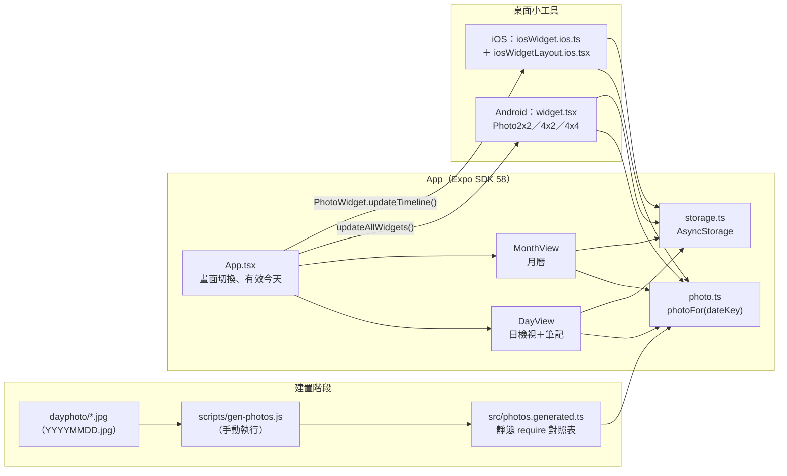

### 2.4 畫面與導覽

現行版沒有使用 Expo Router，也沒有 `src/app/` 目錄。導覽是 `App.tsx` 內的狀態 `view: 'day' | 'month'`，依狀態切換兩個畫面（`App.tsx:28`、`App.tsx:79-98`）。「模擬今天」讀取完成前不渲染任何畫面（`App.tsx:35-40`）。

| 操作 | 行為 | 程式位置 |
|---|---|---|
| 日檢視 → 月曆 | 按「月曆」按鈕，或 Android 實體返回鍵；開啟所選日期所在月份 | `DayView.tsx:155`、`App.tsx:54-67` |
| 月曆 → 日檢視 | 點選日期格 | `MonthView.tsx:81`、`App.tsx:93-96` |
| 換日 | ‹／› 前後一天 | `DayView.tsx:145,152` |
| 回到今天 | 已在今天時按鈕停用 | `DayView.tsx:156` |
| 換月 | ‹／› 前後一個月 | `MonthView.tsx:22-25,54-56` |

沒有滑動手勢，只有按鈕。`predictiveBackGestureEnabled` 為 false（`app.json:21`）。月曆畫面的返回鍵沒有攔截，推測會套用系統預設行為，App 退到背景。

> 注意：專案的 `AGENTS.md` 規定導覽要用 Expo Router，現行實作與此規定不一致。新版畫面變多（付費牆、商店、設定、帳號），建議改版時一併遷移到 Expo Router（見 4.5）。

### 2.5 功能清單

| 編號 | 功能 | 說明 | 程式位置 |
|---|---|---|---|
| V1-01 | 日期標題 | 顯示「YYYY年M月D日 星期X」，今天加註「今天」或「今天（模擬）」 | `DayView.tsx:147-150`、`dates.ts:33-36` |
| V1-02 | 當日照片 | 滿版寬、依原比例顯示；該日無照片時顯示「這天沒有圖片」 | `DayView.tsx:166-178` |
| V1-03 | 筆記編輯 | 多行輸入，提示文字「寫下這一天的心情…」，筆記載入完成前鎖定 | `DayView.tsx:49,186-196` |
| V1-04 | 自動儲存 | 停止輸入 600 ms、失去焦點、App 進背景、離開該日時自動儲存 | `DayView.tsx:23,102-125,192` |
| V1-05 | 手動儲存 | 「儲存」按鈕只在有未存修改時可按；存完顯示 Toast「已儲存」 | `DayView.tsx:132-135,184` |
| V1-06 | 儲存狀態 | 編輯中…／儲存中…／✓ 已儲存 HH:MM／儲存失敗；失敗保留待存並重試 | `DayView.tsx:87-89,227-240` |
| V1-07 | 月曆格 | 標題「YYYY年M月」、週日起始的星期列；每格以照片為背景並標示日數 | `MonthView.tsx:55-65,104-108` |
| V1-08 | 今天標示 | 今天的日數標籤以強調色填滿 | `MonthView.tsx:107-108,184-194` |
| V1-09 | 筆記標記 | 有筆記的日期顯示圓點（單次 multiGet 取得） | `MonthView.tsx:33-43,110,195-205` |
| V1-10 | 模擬今天 | 測試用：把正在看的日期設成「今天」或清除；會影響 App 與小工具。目前沒有 `__DEV__` 保護，正式版也看得到 | `DayView.tsx:198-220`、`App.tsx:32-33,69-73` |
| V1-11 | Android 小工具 | 2x2、4x2、4x4 三種尺寸，顯示今天的照片、日期與筆記摘要 | `widget.tsx`、`app.json:27-63` |
| V1-12 | iOS 小工具 | small／medium／large 三種，內容同上，預先排 14 天時間軸 | `iosWidget.ios.ts`、`iosWidgetLayout.ios.tsx` |

程式中沒有農曆、節日、小語，也沒有筆記以外的文字內容。

### 2.6 資料模型

全部資料存在 AsyncStorage（`storage.ts`），沒有結構版本控管。

| 鍵 | 值 | 說明 |
|---|---|---|
| `note:YYYYMMDD` | 字串 | 該日筆記；存空白會刪除此鍵（`storage.ts:6,9-19`） |
| `simulatedToday` | `YYYYMMDD` 或不存在 | 模擬今天（`storage.ts:7,29-39`） |

有效今天＝模擬今天 ?? 裝置本地今天（`storage.ts:42-44`）。Android 小工具的背景工作讀取同一份 AsyncStorage。

iOS 另外在 expo-widgets 的 widgetsDirectory（App Group）存放縮小後的照片副本，檔名 `${asset.name}-${asset.hash}-600q85.jpg`（`iosWidget.ios.ts:30-33`）；小工具時間軸的參數存在 UserDefaults，所以全部是字串（`iosWidgetLayout.ios.tsx:23-30`）。

### 2.7 照片產製與對應規則

1. 照片放在 `dayphoto/`，檔名必須是 `YYYYMMDD.jpg` 且為真實日期（`gen-photos.js:11-27`）。
2. 手動執行 `npm run gen-photos`，產生 `src/photos.generated.ts`。因為 Metro 只打包靜態 `require`，所以產生的是一份靜態對照表（`gen-photos.js:1-2,30-41`）。此步驟沒有接進建置流程。
3. 照片隨安裝檔打包，`dayphoto/` 約 5.8 MB；原圖為 852×951 JPEG。
4. 目前有 61 張有效照片：2026-11-01～11-30（30 張）與 2027-01-01～01-31（31 張）。2026 年 12 月整月缺圖。另有一張 `1792766042833.jpg` 檔名不符規則，會被略過。
5. `photoFor(dateKey)`（`photo.ts:12-15`）：該日有照片就用該日的；沒有照片且日期 ≥ `20261024` 時，一律顯示 `20261101.jpg`；更早的日期顯示「這天沒有圖片」。所以 2026 年 12 月與 2027-02-01 以後的每一天都會顯示 11/1 那張。

更新照片必須重跑產生腳本並重新建置、發佈 App。

### 2.8 桌面小工具

**Android**（react-native-android-widget）

| 名稱 | 版面 | 備註 |
|---|---|---|
| Photo2x2 | 照片＋「M/D（X）」 | `widget.tsx:85-113` |
| Photo4x2 | 左側照片（最多 45% 寬）；右側「M月D日」、「YYYY 星期X」、筆記摘要（行數依高度計算） | `widget.tsx:115-168` |
| Photo4x4 | 上方照片，下方短日期與筆記摘要；唯一可調整大小的尺寸 | `widget.tsx:170-220`、`app.json:49` |

- 小工具以 JSX 描述、由函式庫轉成點陣圖。筆記為空顯示「（還沒有筆記）」，沒照片顯示佔位圖。
- 只會顯示「有效今天」（`widget.tsx:36-39`）。
- 系統每 30 分鐘觸發更新（`updatePeriodMillis: 1800000`）。背景工作在 `index.ts:12` 註冊，處理 WIDGET_ADDED／UPDATE／RESIZED 事件（`widget.tsx:232-247`）。
- App 主動更新的時機：啟動、回到前景、變更模擬今天、儲存今天的筆記（`App.tsx:41,48,72`、`DayView.tsx:78`）。
- 點小工具只會開啟 App（`OPEN_APP`），不能直接開到指定日期。
- 推測：跨過午夜後若沒有開 App，小工具最多可能顯示前一天約 30 分鐘。

**iOS**（expo-widgets）

- 小工具名稱 `PhotoWidget`，支援 systemSmall／Medium／Large（`app.json:73-89`）。
- 版面函式會被轉成字串、在擴充程式中獨立執行，只能使用 `@expo/ui/swift-ui` 與傳入的參數，不能 import 其他模組，所以配色是複製 `colors.ts` 的 4 個色碼（`iosWidgetLayout.ios.tsx:1-6,33-38`）。
- App 一次排 14 天的時間軸，每個本地午夜一筆，並把照片縮成長邊 600 px、JPEG 品質 0.85（理由為 WidgetKit 的圖片大小限制）（`iosWidget.ios.ts:15-20,36-73`）。
- 沒有設定 App Group，使用外掛預設值 `group.com.photocalendar.app`。
- 推測：14 天內都沒開 App，時間軸就會用完。

**Android 自動連結排除**：`package.json` 把 expo-widgets、@expo/ui、react-native-safe-area-context、expo-image-manipulator、expo-image-loader 排除在 Android 自動連結之外，因為它們只在 `*.ios.*` 檔案使用。推測目的是加入 iOS 時不改變 Android 的原生模組組成。

### 2.9 日期規則

- 日期鍵為裝置本地時間的 `YYYYMMDD`，沒有時區函式庫、沒有 UTC 換算（`dates.ts:1-30`）。
- 星期為「日～六」，週日起始；月曆格補前後空白成整週，4～6 列平均分配高度（`MonthView.tsx:29-31,45-47,67`）。
- 本地今天只在 App 回到前景時重新讀取。推測：App 開著跨過午夜，「今天」不會更新。

### 2.10 平台差異

| 項目 | iOS | Android |
|---|---|---|
| 安全區域 | react-native-safe-area-context（`safeArea.ios.tsx`） | StatusBar 高度＋固定底部 24（`safeArea.tsx:6`） |
| Toast | 自繪頂部浮層 2000／3500 ms，含無障礙朗讀（`toast.ios.tsx`） | ToastAndroid（`toast.ts`） |
| 小工具 | expo-widgets；Android 的呼叫在 iOS 上是 no-op | react-native-android-widget；iOS 呼叫有 no-op 替身（`iosWidget.ts`） |
| 返回鍵 | 不適用 | 日檢視時攔截為「回月曆」 |

### 2.11 建置與部署

- `eas.json`：版本號由 EAS 遠端管理；`preview` 為內部發佈；`production` 自動遞增版號。沒有 development profile，也沒有 submit 設定；`app.json` 沒有 EAS projectId／owner。
- Android release 關閉 R8 縮減（`enableMinifyInReleaseBuilds: false`）。依專案記憶：R8 曾破壞 WorkManager 導致啟動閃退。
- `metro.config.js` 可用 `METRO_MAX_WORKERS` 限制 Metro 工作數，因應建置機器記憶體不足。
- 專案目前不是 git 儲存庫；`dist/photocalendar-android.apk` 為本機建置產物。

### 2.12 現行限制與問題

| 編號 | 問題 | 新版處理方式 |
|---|---|---|
| L-01 | 照片打包在安裝檔，換圖要重新建置發佈；12 月缺圖、2 月起全部顯示同一張 | 改由後台提供內容（5.1） |
| L-02 | 沒有小語 | 新增小語欄位（5.1） |
| L-03 | 備援照片日期寫死在程式（`photo.ts:7-8`） | 改由後台設定備援內容（5.1.5） |
| L-04 | 「模擬今天」在正式版可見 | 限開發版顯示（APP-13） |
| L-05 | 筆記只存本機，移除 App 即遺失，沒有備份 | v2.0 維持本機；雲端備份列為 P2（APP-15） |
| L-06 | 沒有任何網路程式、帳號、付費、分析與錯誤回報 | 第 4～6 章 |
| L-07 | 配色寫死在模組層級的 StyleSheet 與小工具程式，無主題概念 | Skin 系統（5.4） |
| L-08 | 沒有測試，只有 lint | 新版補單元測試（10.6） |
| L-09 | 沒有使用 Expo Router，與 AGENTS.md 規定不一致 | 改版時遷移（4.5） |
| L-10 | iOS 版從未在 EAS 建置或實機執行過，App Group 未驗證（專案記憶） | 第 0 階段驗證（12 章） |
| L-11 | App 開著跨午夜不會換日；小工具不能深連結到指定日期 | APP-03、APP-05 |

### 2.13 新版銜接點

| 銜接點 | 現行位置 | 新版做法 |
|---|---|---|
| 某日照片 | `photoFor(dateKey)`（`photo.ts:12-15`），呼叫端：`DayView.tsx:137`、`MonthView.tsx:101`、`widget.tsx:56,177`、`iosWidget.ios.ts:57` | 保留同步函式介面，改從本機內容快取索引取值（4.5） |
| 依賴打包資源的程式 | `Image.resolveAssetSource`（`DayView.tsx:138`、`widget.tsx:45`）、`Asset.fromModule().downloadAsync`（`iosWidget.ios.ts:31-33`） | 改用 API 回傳的寬高與快取檔案路徑 |
| 文字內容 | DayView 標題區（`DayView.tsx:147-150`）；小語建議放在照片（166-179）與筆記標題（181）之間 | 新增小語區塊 |
| 小工具資料 | Android `WidgetData {dateKey, note}`（`widget.tsx:26-29`）；iOS `PhotoWidgetProps`（`iosWidgetLayout.ios.tsx:24-30`） | 增加 `quote`、`quoteSource` 與 Skin 色碼欄位 |
| 配色 | `colors.ts` 9 個 token，散佈在各模組 StyleSheet；`MonthView.tsx:182` 另有寫死色碼 | 改由 SkinProvider 提供（5.4） |
| 持久化 | `storage.ts` 是唯一儲存層 | 擴充內容快取、權益快取、Skin 設定 |

> Android `ImageWidget` 只接受 `require`、http(s) 網址或 `data:image`，不接受 `file://`（函式庫型別定義）。新版小工具要顯示下載的圖片，必須改用 data URI 或網址（見 5.5）。

---

## 3. 新版需求分析（v2.0）

### 3.1 目標

1. 營運人員不必改程式、不必重新發佈 App，就能在後台編輯、排程、抽換每天的圖片與小語。
2. 以月訂閱制產生穩定收入：免費版可以用但有廣告，訂閱去廣告並解鎖完整內容與進階功能。
3. 以 Skin（日曆主題）單次買斷作為額外收入，免費會員也能購買。
4. 保留 v1 已有的核心體驗：日檢視、月曆、筆記、桌面小工具，並能離線使用。
5. 免費版以廣告產生收入，同時作為轉換訂閱的動機。

### 3.2 使用者角色

| 角色 | 說明 |
|---|---|
| 免費使用者 | 安裝即可使用，系統自動建立匿名帳號，不強制登入 |
| 訂閱會員 | 擁有有效的月訂閱權益 |
| Skin 擁有者 | 買過任一 Skin 的使用者（可與上兩者重疊） |
| 超級管理員 | 後台全部權限，含帳號與角色管理、系統參數 |
| 內容編輯 | 管理每日內容、素材庫、批次匯入 |
| Skin 設計／商品管理 | 管理 Skin 資料、素材包、上下架；管理貼圖包 |
| 客服營運 | 查詢會員、訂閱與交易，處理補償 |
| 報表檢視 | 唯讀儀表板與報表 |

### 3.3 方案與權益

依決策 D-03，預設規則如下。表中標示「參數」者存放在後台系統參數，可在後台調整而不必發佈 App（見 ADM-13、7.3.16）。

| 項目 | 免費 | 月訂閱 | 參數 |
|---|---|---|---|
| 今天的圖片＋小語 | ✓ | ✓ | — |
| 過去日期的圖文 | 鎖定（顯示模糊預覽） | ✓ 全部已發佈日期 | `free.pastDays`（預設 0） |
| 未來日期的圖文 | 鎖定 | ✓ 今天起 31 天內 | `premium.previewDays`（預設 31） |
| 月曆瀏覽 | ✓（非今天的格子顯示鎖定樣式） | ✓ | — |
| 筆記（本機） | ✓ | ✓ | — |
| 桌面小工具 | ✓（顯示今天的圖文） | ✓ | `free.widgetEnabled`（預設 true） |
| 預設 Skin | ✓ | ✓ | — |
| 付費 Skin | 可單買 | 可單買 | — |
| 廣告 | 顯示（5.7） | 不顯示 | `ads.enabled`（預設 true） |
| 筆記附件 | 每天 1 個，僅 JPEG／PNG，單檔 ≤ 5 MB | 每天 10 個，JPEG／PNG／HEIC／GIF／WebP／MP4／MOV／PDF，單檔 ≤ 50 MB | `free.attachment.*`、`premium.attachment.*` |
| 貼圖 | 免費貼圖包 | 免費＋訂閱專屬貼圖包 | `sticker.maxPerDay`（預設 20） |
| 分享卡片 | ✓（帶 App 浮水印） | ✓（無浮水印） | `share.watermark`（預設 true） |
| 筆記雲端備份（P2） | — | ✓ | — |

說明：

- 依 D-04，免費版也能使用桌面小工具（v1 的主要賣點），內容同樣只有今天。參數保留，日後若要改成訂閱權益可直接切換。
- 依 D-05，首次訂閱提供免費試用（建議 7 天）。試用資格由商店判定：Apple 每個 Apple ID 在同一訂閱群組只能享有一次推出優惠；Google 依優惠的資格條件設定。
- 依 D-08，免費版顯示廣告，訂閱期間（含試用）不顯示；權益狀態尚未確定時（例如剛啟動還沒讀到快取）也不顯示，避免訂閱者看到廣告閃一下（5.7）。
- 依 D-10，「進階功能」是訂閱權益的統稱；付費牆的權益清單從 `/config` 取得，新增進階功能時只改參數，不必發版。
- 附件與貼圖的限制數值為建議值，列入 Q-16 待確認；全部放在系統參數，可隨時調整。
- 訂閱到期後：已存在的附件與已貼的貼圖保留、仍可檢視；新增附件回到免費限制，專屬貼圖不能再新貼；分享卡片恢復浮水印。
- Skin 買斷後永久擁有，訂閱到期不影響。訂閱到期後歷史內容回到鎖定，已購 Skin 仍可在 App 與小工具套用。
- 為了讓小工具跨午夜仍有圖，伺服器對免費使用者也回傳「明天」的內容供預載，但 App 在當天到來前不顯示（5.2.3）。

### 3.4 功能需求 — App 端

| 編號 | 功能 | 說明 | 優先 |
|---|---|---|---|
| APP-01 | 日檢視 | 圖片＋小語＋出處＋日期＋筆記；鎖定日期顯示模糊預覽與「訂閱解鎖」 | P0 |
| APP-02 | 月曆 | 縮圖格、今天標示、筆記標記；鎖定格顯示鎖頭 | P0 |
| APP-03 | 內容同步與離線快取 | 啟動、回到前景、跨午夜時同步；無網路時顯示快取；完全沒有快取時顯示內建備援圖 | P0 |
| APP-04 | 筆記 | 沿用 v1 全部行為（自動儲存、狀態列、重試） | P0 |
| APP-05 | 桌面小工具 | 沿用 v1 三＋三種尺寸，新增小語與 Skin 配色；點擊開到當天（深連結） | P0 |
| APP-06 | 付費牆與訂閱 | 顯示方案、價格（由商店提供）、自動續訂條款、隱私權政策與使用條款連結 | P0 |
| APP-07 | 恢復購買／管理訂閱 | 「恢復購買」按鈕；「管理訂閱」導向商店訂閱管理頁 | P0 |
| APP-08 | Skin 商店 | 列表、詳情（預覽圖＋即時試套）、購買 | P1 |
| APP-09 | 我的 Skin | 已擁有 Skin 列表、套用、下載與更新素材包 | P1 |
| APP-10 | 帳號 | 匿名帳號自動建立；選擇性以 Apple／Google 登入以跨裝置還原；App 內刪除帳號 | P0（匿名、刪除）／P1（登入） |
| APP-11 | 設定 | 隱私權政策、使用條款、版本資訊、聯絡客服、恢復購買 | P0 |
| APP-12 | 強制更新與公告 | 低於最低版本時提示更新；顯示後台公告 | P1 |
| APP-13 | 模擬今天 | 僅開發版（`__DEV__`）顯示 | P0 |
| APP-14 | 每日推播 | 每天定時推播當日小語 | P2 |
| APP-15 | 筆記雲端備份（含附件與貼圖資料） | 訂閱權益之一 | P2 |
| APP-16 | 廣告 | 免費版在日檢視與月曆顯示橫幅、在換日／換月達到頻率門檻時顯示插頁；訂閱者與權益未知時不顯示；付費牆與購買流程中不顯示 | P0 |
| APP-17 | 筆記附件 | 每天的筆記可附加照片、影片或檔案；格式、數量、大小依方案限制；附件只存本機；月曆標示有附件的日期 | P1 |
| APP-18 | 貼圖 | 日檢視可貼裝飾貼圖（拖曳、縮放、旋轉、刪除）；貼圖包由後台上架並由 App 下載；專屬貼圖包限訂閱者 | P1 |
| APP-19 | 分享卡片 | 將當日圖片、小語、日期（可選筆記與貼圖）輸出成圖片，透過系統分享到 IG、LINE 或存到相簿；免費版帶浮水印 | P1 |

### 3.5 功能需求 — 管理後台

| 編號 | 功能 | 說明 | 優先 |
|---|---|---|---|
| ADM-01 | 登入 | 帳號密碼＋TOTP 雙因素驗證，閒置逾時登出 | P0 |
| ADM-02 | 儀表板 | 今天上線內容、未來 30 天缺漏、有效訂閱數、近 30 天 Skin 銷售 | P1 |
| ADM-03 | 每日內容月曆總覽 | 以月曆格呈現每天狀態（已發佈／草稿／已排程抽換／缺漏） | P0 |
| ADM-04 | 單日內容編輯 | 小語、出處、授權說明、圖片；即時預覽 App 日檢視、月曆格與各尺寸小工具 | P0 |
| ADM-05 | 圖片上傳與處理 | 上傳原圖後自動產生各尺寸版本與模糊預覽碼 | P0 |
| ADM-06 | 批次匯入 | CSV＋圖片 ZIP（檔名沿用 `YYYYMMDD.jpg`），匯入前預覽與驗證 | P1 |
| ADM-07 | 發佈、排程抽換、下架、版本歷史 | 每次修改產生新版本；可指定生效時間；可回復舊版本 | P0 |
| ADM-08 | 缺漏檢查與備援內容 | 未來 N 天缺內容時警示；設定沒有內容時使用的備援圖文 | P0 |
| ADM-09 | Skin 管理 | 基本資料、商店商品代號、設計 token 編輯、素材包上傳、預覽、上下架 | P1 |
| ADM-10 | 會員查詢 | 以會員 ID、登入信箱、商店交易編號查詢 | P1 |
| ADM-11 | 訂閱與交易查詢 | 唯讀，資料來自訂閱同步（第 6 章） | P1 |
| ADM-12 | 手動授予權益 | 客服補償、活動贈送（記錄原因與期限） | P2 |
| ADM-13 | 系統參數 | 免費方案規則、最低 App 版本、公告、維護模式 | P0 |
| ADM-14 | 後台帳號與角色 | 新增停用帳號、指派角色、重設雙因素 | P0 |
| ADM-15 | 稽核紀錄 | 記錄所有後台寫入操作（誰、何時、改了什麼） | P1 |
| ADM-16 | 營運報表 | Skin 銷售排行、訂閱轉換、內容瀏覽統計 | P2 |
| ADM-17 | 貼圖包管理 | 建立貼圖包、上傳貼圖（透明背景 PNG）、設定免費或訂閱專屬、預覽、上下架 | P1 |
| ADM-18 | 廣告與加值功能參數 | 廣告開關與插頁頻率、附件限制、貼圖每日上限、分享浮水印；屬系統參數頁（ADM-13）的分頁 | P0（廣告參數，第 2 階段）／P1（附件、貼圖、分享參數，第 4 階段） |

### 3.6 功能需求 — 後端服務

| 編號 | 功能 | 說明 | 優先 |
|---|---|---|---|
| SVC-01 | App 身分驗證 | 匿名註冊、權杖簽發與更新、帳號連結 | P0 |
| SVC-02 | 內容 API | 依使用者權益過濾可看的日期 | P0 |
| SVC-03 | Skin 目錄與下載 | 目錄、擁有狀態、素材包下載網址 | P1 |
| SVC-04 | 權益查詢 | 回傳目前訂閱與已購 Skin | P0 |
| SVC-05 | 購買同步 | 接收訂閱服務事件、主動重新同步、對帳 | P0 |
| SVC-06 | 排程工作 | 排程抽換生效、缺漏警示、事件重試、每日對帳、過期清理 | P0 |
| SVC-07 | 圖片處理 | 產生尺寸版本、計算雜湊與模糊預覽碼 | P0 |
| SVC-08 | 帳號刪除 | 刪除個資與身分資料，保留法定必要的交易紀錄 | P0 |
| SVC-09 | 貼圖包目錄與下載 | 目錄、可用狀態（免費／專屬）、貼圖包下載網址 | P1 |

非功能需求見第 10 章。

---

## 4. 系統架構設計

### 4.1 架構總覽

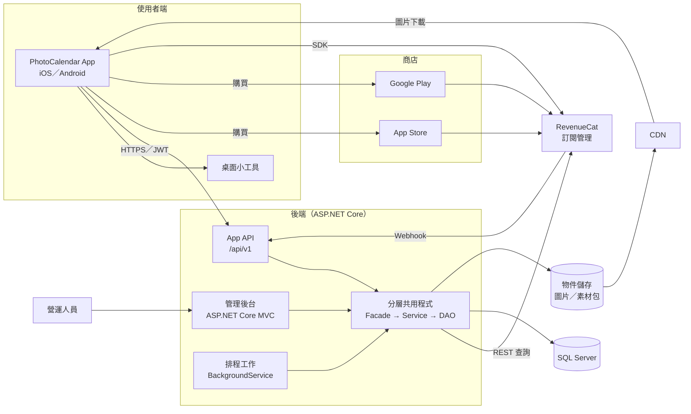

設計原則：

- **伺服器是內容授權的唯一依據**：App 拿得到哪些日期的圖文，由 API 依資料庫中的權益決定，不信任 App 自報。
- **商店與 RevenueCat 是付款的依據**：後端不直接處理任何卡號或付款資料，只同步「誰擁有什麼」（第 6 章）。
- **圖片走 CDN**：API 只回傳網址，圖片流量不經過應用伺服器。
- **離線優先**：App 端所有內容與權益都有本機快取，伺服器暫停時 App 仍可使用。

### 4.2 技術選型

| 層 | 選擇 | 理由／備註 |
|---|---|---|
| 執行平台 | .NET 10（LTS） | 長期支援版本 |
| App API | ASP.NET Core Web API | JSON、JWT Bearer、ProblemDetails 錯誤格式 |
| 後端架構 | Controller → Facade → Service → DAO 分層 | 依 D-07，見 4.6 |
| 管理後台 | ASP.NET Core MVC（Controller ＋ Razor Views） | 提供分層架構的 Controller 入口；與 App API 共用 Common 專案；互動較多的頁面（內容月曆、即時預覽）以少量前端 JS 處理 |
| 資料存取 | Dapper（DAO 層）＋ DbUp 版本化 SQL 腳本 | 沿用既有分層慣例（`CommonDao<T>`），SQL 由 DAO 掌握；後台帳號的 Identity 資料表例外使用 EF Core store（4.6.3） |
| 資料庫 | SQL Server 2022 或 Azure SQL Database | 依 D-01 |
| 後台身分 | ASP.NET Core Identity ＋ TOTP 雙因素 | 內建、免額外費用 |
| App 身分 | 自簽 JWT（存取權杖 1 小時、更新權杖 90 天輪替） | 匿名優先 |
| 物件儲存 | Azure Blob Storage 或 Cloudflare R2（S3 相容） | 以 `IFileStorage` 介面隔離；R2 無流出費用 |
| CDN | Azure Front Door／CDN 或 Cloudflare | 依物件儲存選擇 |
| 圖片處理 | SkiaSharp（MIT）或 ImageSharp | ImageSharp 採 Six Labors Split License，商用前需確認授權條件 |
| 排程 | .NET BackgroundService（必要時改 Quartz.NET 或 Hangfire） | 工作量小，先不引入外部排程 |
| 訂閱管理 | RevenueCat | 見第 6 章 |
| 日誌與監控 | Serilog ＋ Application Insights（或 Seq） | 結構化日誌、錯誤告警 |
| App 端新增套件 | 見 4.5 | 一律以 `npx expo install` 安裝 |

### 4.3 .NET 方案結構

```
PhotoCalendar.sln
├─ src/
│  ├─ PhotoCalendar.Common         分層共用程式（Facade、Service、DAO、Client、Model、DTO）
│  │  ├─ Interfaces/
│  │  │  ├─ Facade/                I{Name}Facade
│  │  │  ├─ Service/               IService<T>、I{Name}Service
│  │  │  ├─ Dao/                   IDAO<T>、I{Entity}Dao
│  │  │  ├─ Data/                  IUnitOfWork（Facade 與 Service 都會用，獨立於 Dao 命名空間）
│  │  │  └─ Client/                I{Name}Client
│  │  ├─ Facades/                  {Name}Facade
│  │  ├─ Services/                 BaseService<T>、{Name}Service
│  │  ├─ Dao/                      CommonDao<T>、UnitOfWork、{Entity}Dao
│  │  ├─ Clients/                  RevenueCatClient、FileStorageClient、ImageProcessorClient、MailClient、JwtClient…
│  │  ├─ Models/                   {Entity}Model（對應資料表）
│  │  ├─ Dtos/                     {UseCase}Request／{UseCase}Response
│  │  ├─ Exceptions/               BusinessException（含錯誤碼）
│  │  └─ DependencyInjection.cs    AddPhotoCalendarLayers()
│  ├─ PhotoCalendar.Api            App API：Controllers、Jobs（BackgroundService）、Program.cs
│  ├─ PhotoCalendar.Admin          管理後台：ASP.NET Core MVC（Controllers、Views、wwwroot）、Program.cs
│  └─ PhotoCalendar.Database       DbUp 主控台程式與 Scripts/*.sql
└─ tests/
   ├─ PhotoCalendar.Common.Tests   Facade、Service 單元測試；分層架構測試
   └─ PhotoCalendar.Api.Tests      Controller 與 DAO 整合測試（WebApplicationFactory ＋ Testcontainers SQL Server）
```

各層的職責與呼叫規則見 4.6。

App API 與管理後台分開部署（不同網域，例如 `api.` 與 `admin.`），後台可再加 IP 白名單。

### 4.4 部署環境

| 環境 | 用途 | 商店／訂閱環境 |
|---|---|---|
| Development | 本機開發 | App Store Sandbox、Play 授權測試帳號、RevenueCat Sandbox |
| Staging | 驗收、商店審核用 | 同上 |
| Production | 正式 | 正式環境 |

App 依 EAS 建置 profile 指向不同 API 網址（`EXPO_PUBLIC_API_BASE_URL`）。`eas.json` 需新增 `development` profile（開發版建置，內購需要開發版，不能用 Expo Go）。

### 4.5 App 端架構調整

| 調整 | 說明 |
|---|---|
| 遷移 Expo Router | 依 AGENTS.md，路由放 `src/app/`：`_layout.tsx`、`index.tsx`（日檢視）、`month.tsx`、`paywall.tsx`、`store/index.tsx`、`store/[code].tsx`、`settings.tsx`、`account.tsx`。小工具深連結 `photocalendar://day/2026-11-05` 也靠路由處理 |
| 內容層 `src/content/` | 本機內容快取與同步。啟動時把快取索引載入記憶體，`photoFor(dateKey)` 維持同步介面但改從索引取值，現有 5 個呼叫端改動最小。回傳值改為 `{ uri, width, height }`，取代 `Image.resolveAssetSource` |
| 權益層 `src/purchases/` | 包裝 RevenueCat SDK 與伺服器權益快取，提供 `useEntitlements()` |
| Skin 層 `src/skin/` | `SkinProvider` ＋ `useSkin()`；預設 Skin 的 token 等於現行 `colors.ts`，模組層級 StyleSheet 改成依 token 產生 |
| API 用戶端 `src/api/` | 權杖儲存（expo-secure-store）、自動更新權杖、逾時與重試 |
| 廣告層 `src/ads/` | 包裝廣告 SDK；依權益決定是否初始化與顯示；插頁頻率控制（5.7） |
| 附件層 `src/attachments/` | 選檔、依 `/config` 的方案限制驗證、存檔與索引、縮圖（5.8） |
| 貼圖層 `src/stickers/` | 貼圖包下載與快取、畫布手勢、每日貼圖資料（5.9） |
| 分享層 `src/share/` | 分享卡片版面、離屏擷取、系統分享（5.10） |
| 內建備援圖 | 安裝檔只保留少量備援圖（建議 3～5 張），取代整包 `dayphoto/` 與 `photos.generated.ts` |
| 移除 | `scripts/gen-photos.js` 的打包用途；iOS 小工具不再需要在裝置上縮圖（伺服器已產生 600 px 版本），expo-image-manipulator 可評估移除 |

預計新增的 Expo 套件（實際版本以 `npx expo install` 解析結果為準，安裝前先查 SDK 58 文件）：expo-router、expo-secure-store、expo-image（模糊預覽、快取）、expo-apple-authentication、expo-background-task（iOS 背景更新小工具）、expo-notifications（P2），以及 RevenueCat 的 react-native-purchases（付費牆可選用 react-native-purchases-ui）。加值功能另需：expo-image-picker 與 expo-document-picker（附件選取）、expo-video（影片附件播放）、expo-sharing（分享與開啟檔案）、react-native-gesture-handler 與 react-native-reanimated（貼圖手勢）、react-native-view-shot 或等效方案（分享卡片擷取），以及 react-native-google-mobile-ads（≥ 17.3.0，5.7）。加入原生模組後需要重新建置開發版。

### 4.6 後端分層架構（Controller → Facade → Service → DAO）

依決策 D-07，後端（App API 與管理後台）一律採分層架構實作。以三層式架構來看：Controller 是表現層，Facade 與 Service 合為商業邏輯層，DAO 是資料存取層。Facade 再把商業邏輯層拆成兩部分：Facade 負責「使用案例的協調」，Service 負責「單一領域的規則」。

命名與基底類別沿用既有的分層慣例：`{Entity}Model`、`IDAO<T>`／`CommonDao<T>`（Dapper）、`IService<T>`／`BaseService<T>`、內建 DI、async/await、primary constructor、file-scoped namespace。本專案在其上新增 Facade 層與 `IUnitOfWork`。

#### 4.6.1 各層職責

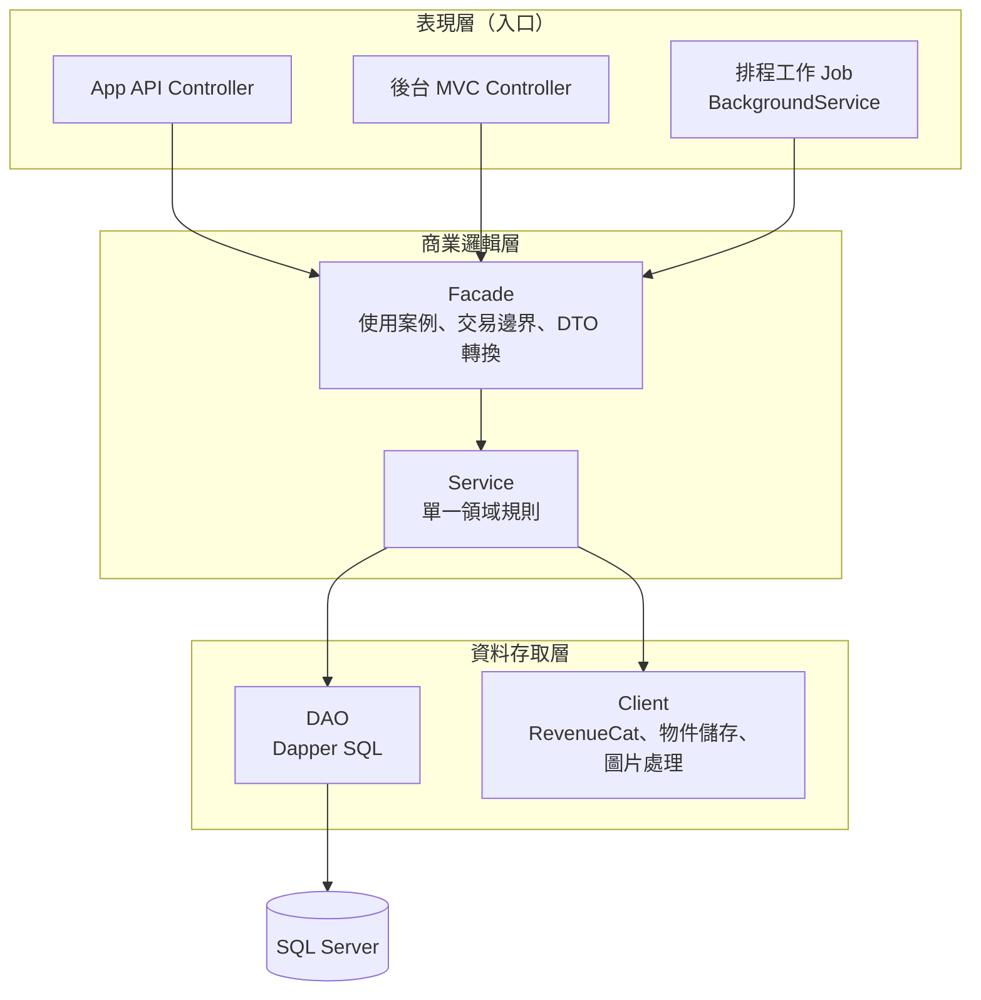

| 層 | 放置位置 | 負責 | 可以呼叫 | 不可以 |
|---|---|---|---|---|
| Controller | `PhotoCalendar.Api/Controllers`、`PhotoCalendar.Admin/Controllers`；排程工作放 `PhotoCalendar.Api/Jobs`，地位等同 Controller | 路由、模型繫結與輸入格式驗證、授權屬性（`[Authorize]`、角色）、取出目前使用者、把 Facade 結果轉成 HTTP 回應或 View | Facade | 呼叫 Service／DAO；寫商業規則；開交易 |
| Facade | `Common/Facades` | 一個使用案例一個方法（例如「儲存內容版本」「同步購買」）；協調多個 Service；決定交易範圍；Request／Response DTO 與 Model 互轉；寫稽核紀錄 | Service、`IUnitOfWork` | 呼叫 DAO 或 Client；寫 SQL；呼叫其他 Facade |
| Service | `Common/Services` | 單一領域的商業規則與驗證，例如權益判斷、可見日期範圍、版本號規則、小語長度 | DAO、Client、`IUnitOfWork.Transaction`（只讀取） | 呼叫其他 Service（跨領域協調交給 Facade）；接觸 HttpContext |
| DAO | `Common/Dao` | 一張表（或一組緊密相關的表）的存取，只放 SQL 與欄位對應 | `IDbConnection` | 商業規則 |
| Client | `Common/Clients` | 外部資源存取：RevenueCat REST、物件儲存、圖片處理、寄信、JWT 簽發、Apple／Google ID Token 驗證；與 DAO 同層 | 外部 API／SDK | 商業規則 |

共同規則：

- 只能往下呼叫，不能跳層，也不能往上；同層之間不互相呼叫，Facade 不呼叫 Facade，Service 不呼叫 Service。這樣相依關係維持單向，交易也只會在 Facade 開一次。
- 每一層都以介面相依（`I{Name}Facade`、`I{Name}Service`、`I{Name}Dao`、`I{Name}Client`），介面放在 `Common/Interfaces/{Facade|Service|Dao|Client}`，`IUnitOfWork` 另放 `Common/Interfaces/Data`（讓架構測試的「Facade 不相依 Dao 命名空間」規則成立），以內建 DI 註冊為 Scoped。
- 資料物件分兩種：Controller ↔ Facade 之間用 `{UseCase}Request`／`{UseCase}Response`（`Common/Dtos`）；Facade ↔ Service ↔ DAO 之間用 `{Entity}Model`（`Common/Models`，對應資料表）。API 的 JSON 結構由 DTO 決定，資料表變更不會直接外流到 App。
- DTO 與 Model 的轉換在 Facade，以手寫對應為主。若使用 AutoMapper，注意新版（v15 起）改為商業授權，採用前確認授權條件。
- 輸入格式（必填、長度、日期格式）在 Controller 以 DataAnnotations 驗證。跟資料有關的規則（例如該日已有排程版本、Skin 代號重複）在 Service 驗證，丟出 `BusinessException`（含錯誤碼），由全域例外處理轉成 8.4 的 ProblemDetails 錯誤碼。
- 排程工作（BackgroundService）是 Singleton，每次執行都要用 `IServiceScopeFactory.CreateAsyncScope()` 建立範圍，再從範圍取得 Facade；不可直接注入 Scoped 的 Facade。

#### 4.6.2 交易與連線

- `IDbConnection`（SqlConnection）與 `IUnitOfWork` 皆註冊為 Scoped，同一個請求共用同一條連線。
- Facade 決定交易範圍：`BeginAsync()` → 呼叫 Service → `CommitAsync()`；發生例外時 `RollbackAsync()`。
- Service 呼叫 DAO 時傳入 `unitOfWork.Transaction`（沒有交易時為 null），對應 `IDAO<T>` 寫入方法既有的 `IDbTransaction? transaction` 參數。
- **Dapper 的限制**：連線有進行中的交易時，每個命令都必須帶 transaction，否則會丟例外。既有 `IDAO<T>` 的讀取方法（`GetAllAsync`、`GetByIdAsync`）沒有 transaction 參數，所以交易內不能呼叫它們。建議本專案在 `IDAO<T>` 的讀取方法也加上 `IDbTransaction? transaction = null`，與寫入方法一致。這是對既有慣例的小幅擴充，在確認前，交易內的讀取一律使用自訂、帶 transaction 參數的 DAO 方法。
- 驗證用的讀取盡量放在開交易之前做，縮短交易時間。
- 呼叫外部服務（RevenueCat、物件儲存）不放在資料庫交易裡：Facade 先呼叫負責外部存取的 Service（由該 Service 呼叫 Client）取得結果，再開交易寫入資料庫，避免長交易鎖表。

```csharp
// Common/Interfaces/Data/IUnitOfWork.cs
namespace PhotoCalendar.Common.Interfaces.Data;

public interface IUnitOfWork
{
    IDbTransaction? Transaction { get; }
    Task BeginAsync();
    Task CommitAsync();
    Task RollbackAsync();
}
```

#### 4.6.3 資料存取慣例

- DAO 一律用 Dapper，繼承 `CommonDao<T>`。本系統資料表採單數命名（第 7 章），與 `CommonDao<T>` 預設的複數表名不同，所以 DAO 建構時明確傳入表名，例如 `CommonDao<DailyContentModel>(dbConnection, "DailyContent")`。
- `IDAO<T>.GetByIdAsync(int)` 只支援 INT 主鍵。GUID 主鍵的表（AppUser、MediaAsset）與複合主鍵的表（MediaAssetVariant、SkinPreviewImage），由各自的 DAO 加上對應的查詢方法。
- `CommonDao<T>.GetAllAsync()` 會讀整張表，只用於小表（AppSetting、Skin、FallbackContent）。大表（DailyContent、DailyContentRevision、Entitlement、StoreTransaction、WebhookEvent、AdminAuditLog）一律寫帶條件與分頁的專用方法。
- 只用參數化查詢；排序欄位等動態部分以白名單對照，不直接串接使用者輸入。
- 資料庫結構以 DbUp 管理：`PhotoCalendar.Database/Scripts/` 下以 `0001_Init.sql` 起依序編號，部署時執行；不使用 EF Core 遷移。
- **例外：後台帳號**。後台帳號使用 ASP.NET Core Identity，其資料存取沿用 Identity 內建的 EF Core store，只用於 AspNet* 資料表。原因是 Identity 的 store 介面涵蓋密碼、雙因素、鎖定、角色，自行以 Dapper 實作成本高，也容易產生安全漏洞。帳號管理（`UserManager`）包在 `AdminAccountService` 內，其他層不接觸。登入與登出需要寫 Cookie，屬於 HTTP 行為，由 `AccountController` 直接使用 `SignInManager`，這是「Controller 只呼叫 Facade」規則的唯一例外。Identity 資料表的建立腳本以 `dotnet ef migrations script` 產生一次後，納入 DbUp 腳本統一管理。

#### 4.6.4 模組對照

App 端與後台的 Facade 分開，例如 `ContentFacade` 與 `ContentAdminFacade`，因為兩邊的授權與 DTO 不同；共用的規則放在 Service。

| 模組 | Controller／Job | Facade | Service | DAO／Client |
|---|---|---|---|---|
| App 身分 | `AuthController` | `AuthFacade` | `UserService`、`TokenService` | `AppUserDao`、`UserIdentityDao`、`DeviceDao`、`RefreshTokenDao`；`JwtClient`、`AppleIdTokenClient`、`GoogleIdTokenClient` |
| App 設定 | `ConfigController` | `ConfigFacade` | `SettingService` | `AppSettingDao` |
| App 內容 | `ContentController` | `ContentFacade` | `EntitlementService`、`ContentService`、`SettingService` | `DailyContentDao`、`DailyContentRevisionDao`、`FallbackContentDao`、`MediaAssetDao`、`MediaAssetVariantDao`；`FileStorageClient`（組 CDN 網址） |
| App Skin | `SkinController` | `SkinFacade` | `SkinService`、`EntitlementService` | `SkinDao`、`SkinVersionDao`、`SkinPreviewImageDao`；`FileStorageClient`（限時下載網址） |
| App 會員 | `MeController` | `MemberFacade` | `UserService`、`EntitlementService` | `AppUserDao`、`UserIdentityDao`、`DeviceDao`、`RefreshTokenDao`、`EntitlementDao` |
| 購買同步 | `PurchaseController`（`/me/purchases/sync`）、`RevenueCatWebhookController`；`WebhookProcessJob`、`ReconcileJob` | `PurchaseFacade` | `PurchaseService`、`EntitlementService`、`WebhookEventService` | `EntitlementDao`、`StoreTransactionDao`、`WebhookEventDao`；`RevenueCatClient` |
| 後台內容 | `DailyContentController`、`ContentImportController`；`ScheduledPublishJob`、`GapCheckJob` | `ContentAdminFacade` | `ContentService`、`MediaService`、`SettingService`、`AuditService` | `DailyContentDao`、`DailyContentRevisionDao`、`FallbackContentDao`、`MediaAssetDao`、`MediaAssetVariantDao`、`AdminAuditLogDao`；`FileStorageClient`、`ImageProcessorClient`、`MailClient` |
| 後台素材 | `MediaController` | `MediaAdminFacade` | `MediaService`、`AuditService` | `MediaAssetDao`、`MediaAssetVariantDao`、`AdminAuditLogDao`；`FileStorageClient`、`ImageProcessorClient` |
| 後台 Skin | `SkinAdminController` | `SkinAdminFacade` | `SkinService`、`MediaService`、`AuditService` | `SkinDao`、`SkinVersionDao`、`SkinPreviewImageDao`、`AdminAuditLogDao`；`FileStorageClient` |
| App 貼圖 | `StickerController` | `StickerFacade` | `StickerService`、`EntitlementService` | `StickerPackDao`、`StickerDao`；`FileStorageClient`（限時下載網址） |
| 後台貼圖 | `StickerAdminController` | `StickerAdminFacade` | `StickerService`、`MediaService`、`AuditService` | `StickerPackDao`、`StickerDao`、`MediaAssetDao`、`AdminAuditLogDao`；`FileStorageClient`、`ImageProcessorClient` |
| 後台會員 | `MemberAdminController` | `MemberAdminFacade` | `UserService`、`EntitlementService`、`PurchaseService`、`AuditService` | `AppUserDao`、`UserIdentityDao`、`DeviceDao`、`EntitlementDao`、`StoreTransactionDao`、`AdminAuditLogDao` |
| 系統參數 | `SettingController` | `SettingAdminFacade` | `SettingService`、`AuditService` | `AppSettingDao`、`AdminAuditLogDao` |
| 後台帳號 | `AccountController`（登入登出，4.6.3 例外）、`AdminUserController` | `AdminAccountFacade` | `AdminAccountService`、`AuditService` | ASP.NET Core Identity（EF Core store）、`AdminAuditLogDao` |
| 稽核查詢 | `AuditLogController`（ADM-15 查詢頁，唯讀） | `AuditAdminFacade` | `AuditService` | `AdminAuditLogDao` |
| 清理工作 | `CleanupJob`（SVC-06：180 天未活動且無購買的匿名會員、WebhookEvent 逾 400 天的 PayloadJson、未引用素材清單） | `MaintenanceFacade` | `UserService`、`WebhookEventService`、`MediaService` | `AppUserDao`、`UserIdentityDao`、`DeviceDao`、`RefreshTokenDao`、`WebhookEventDao`、`MediaAssetDao` |
| 儀表板與報表 | `DashboardController`、`ReportController` | `DashboardFacade`、`ReportFacade` | `ContentService`、`EntitlementService`、`ReportService` | `ReportDao`（唯讀彙總查詢）及上列 DAO |

後台角色在程式中的名稱：`SuperAdmin`（超級管理員）、`ContentEditor`（內容編輯）、`SkinManager`（Skin 設計／商品管理，含貼圖包）、`Support`（客服營運）、`ReportViewer`（報表檢視），權限依 5.6.2。

#### 4.6.5 範例：後台儲存一天的內容版本

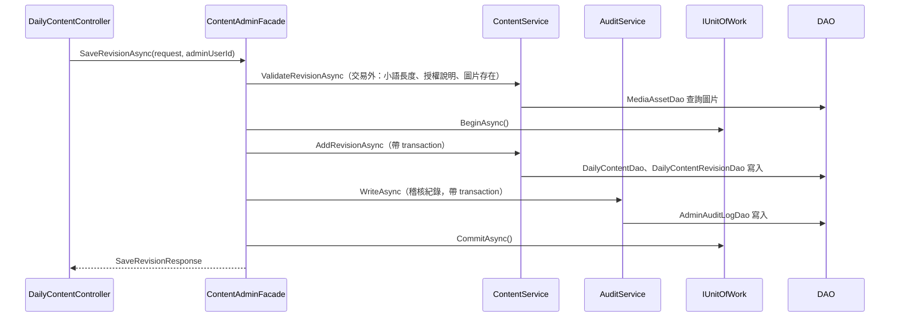

```csharp
// PhotoCalendar.Admin/Controllers/DailyContentController.cs
namespace PhotoCalendar.Admin.Controllers;

[Authorize]
public class DailyContentController(IContentAdminFacade contentAdminFacade) : Controller
{
    private readonly IContentAdminFacade _contentAdminFacade = contentAdminFacade;

    // 讀取（Calendar、Edit）開放全部後台角色（5.6.2）；寫入限內容編輯與超級管理員
    [HttpPost, ValidateAntiForgeryToken]
    [Authorize(Roles = "SuperAdmin,ContentEditor")]
    public async Task<IActionResult> SaveRevision(SaveRevisionRequest request)
    {
        if (!ModelState.IsValid) return View("Edit", request);

        var adminUserId = User.FindFirstValue(ClaimTypes.NameIdentifier)!;
        await _contentAdminFacade.SaveRevisionAsync(request, adminUserId);
        return RedirectToAction("Calendar", new { month = request.ContentDate.ToString("yyyy-MM") });
    }
}
```

```csharp
// Common/Facades/ContentAdminFacade.cs
namespace PhotoCalendar.Common.Facades;

public class ContentAdminFacade(
    IContentService contentService,
    IAuditService auditService,
    IUnitOfWork unitOfWork) : IContentAdminFacade
{
    private readonly IContentService _contentService = contentService;
    private readonly IAuditService _auditService = auditService;
    private readonly IUnitOfWork _unitOfWork = unitOfWork;

    public async Task<SaveRevisionResponse> SaveRevisionAsync(SaveRevisionRequest request, string adminUserId)
    {
        var revision = new DailyContentRevisionModel
        {
            QuoteText = request.QuoteText,
            QuoteSource = request.QuoteSource,
            ImageAssetId = request.ImageAssetId,
            LicenseInfo = request.LicenseInfo,
            EffectiveAtUtc = request.EffectiveAtUtc,
            CreatedBy = adminUserId,
        };

        // 交易外先驗證（含讀取），縮短交易時間
        await _contentService.ValidateRevisionAsync(request.ContentDate, revision);

        await _unitOfWork.BeginAsync();
        try
        {
            var saved = await _contentService.AddRevisionAsync(request.ContentDate, revision);
            await _auditService.WriteAsync(adminUserId, "DailyContent.SaveRevision",
                "DailyContent", saved.DailyContentId.ToString(), after: saved);
            await _unitOfWork.CommitAsync();
            return new SaveRevisionResponse(saved.DailyContentId, saved.RevisionNo);
        }
        catch
        {
            await _unitOfWork.RollbackAsync();
            throw;
        }
    }
}
```

DI 註冊：App API 與管理後台兩個主程式都要註冊同一組 Common 類別，所以集中寫成 `Common` 內的一個擴充方法，兩邊的 `Program.cs` 各呼叫一次。

```csharp
// Common/DependencyInjection.cs
namespace PhotoCalendar.Common;

public static class DependencyInjection
{
    public static IServiceCollection AddPhotoCalendarLayers(this IServiceCollection services, IConfiguration configuration)
    {
        services.AddScoped<IDbConnection>(_ =>
            new SqlConnection(configuration.GetConnectionString("DefaultConnection")));
        services.AddScoped<IUnitOfWork, UnitOfWork>();

        // DAO
        services.AddScoped<IDailyContentDao, DailyContentDao>();
        // …其餘 DAO、Client

        // Service
        services.AddScoped<IContentService, ContentService>();
        // …其餘 Service

        // Facade
        services.AddScoped<IContentAdminFacade, ContentAdminFacade>();
        // …其餘 Facade
        return services;
    }
}
```

#### 4.6.6 測試與分層檢查

| 層 | 測試方式 |
|---|---|
| Facade | 單元測試：mock Service 與 `IUnitOfWork`，驗證協調順序、交易提交與回滾 |
| Service | 單元測試：mock DAO 與 Client，驗證商業規則（權益判斷、可見日期、版本號） |
| DAO | 整合測試：Testcontainers 啟動 SQL Server、執行 DbUp 腳本後測 SQL |
| Controller | 整合測試：WebApplicationFactory 測授權、輸入驗證、錯誤碼 |
| 分層規則 | 以 NetArchTest 寫架構測試：Controller 不得相依 `Interfaces.Service`／`Interfaces.Dao`／`Interfaces.Client`；Facade 不得相依 `Interfaces.Dao`／`Interfaces.Client`（`Interfaces.Data` 的 `IUnitOfWork` 不在此限）；Service 不得相依其他 Service 實作與 `Interfaces.Facade` |

Facade、Service、DAO 都放在同一個 `PhotoCalendar.Common` 專案，沿用既有「Common 專案＋Web 專案」的慣例，所以分層由架構測試把關，不靠專案參考。若之後要更強的隔離，可以再拆成 Facade／Service／Dao 三個專案，用專案參考限制呼叫方向。

---

## 5. 功能模組設計

### 5.1 每日內容（圖片＋小語）

#### 5.1.1 內容模型

每個日期（每個語系）一筆「每日內容」，底下有多個「版本」。App 只看得到「目前上線版本」。

| 欄位 | 說明 | 規則 |
|---|---|---|
| 日期 | 日曆日期，不含時區 | 每語系唯一 |
| 語系 | 預設 `zh-TW` | v2.0 只用 zh-TW |
| 小語 | 正文 | 必填，建議 ≤ 60 字（小工具 4x2 約可顯示 3～4 行），硬上限 300 字 |
| 出處 | 作者、書名或來源 | 選填，≤ 100 字 |
| 圖片 | 素材庫中的一張圖 | 必填 |
| 授權說明 | 圖片與小語的授權來源 | 必填（後台驗證），供版權查核 |
| 可分享 | 是否允許使用者以分享卡片（5.10）輸出這一天的圖片 | 預設允許；圖片授權不允許再散布時關閉 |
| 編輯備註 | 內部用 | 選填 |

#### 5.1.2 內容狀態

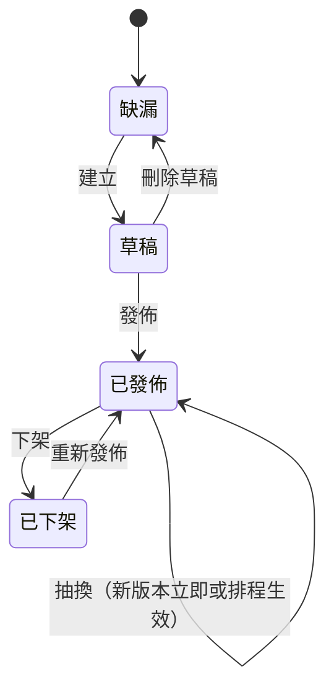

- **已發佈** 的日期才會出現在 API；是否回傳給某位使用者，再依 3.3 的權益規則判斷。
- **抽換**：修改已發佈內容會產生新版本。可選「立即生效」或指定「生效時間」；排程工作在時間到時切換上線版本。
- **下架**：App 端該日改顯示備援內容。
- **版本歷史**：每個版本保留完整內容，可一鍵回復成新版本（不覆寫舊紀錄）。

#### 5.1.3 後台編輯流程

1. 月曆總覽（ADM-03）以顏色區分已發佈、草稿、已排程抽換、缺漏，並標示今天。
2. 點日期進入編輯頁（ADM-04）：輸入小語與出處，從素材庫選圖或直接上傳。
3. 右側即時預覽：App 日檢視、月曆格、Android 2x2／4x2／4x4、iOS small／medium／large；預覽可切換 Skin，確認小語長度在各版面不被截斷。
4. 儲存為草稿或直接發佈；已發佈內容的修改會詢問「立即生效／排程生效」。
5. 每次寫入記錄稽核紀錄（ADM-15）。

#### 5.1.4 圖片規格

| 版本代號 | 尺寸（長邊） | 格式 | 用途 |
|---|---|---|---|
| `original` | 原圖 | 原格式 | 僅保存，不對外公開 |
| `full` | 1440 px | JPEG q80 | 日檢視 |
| `widget` | 600 px | JPEG q85 | 小工具（沿用 v1 的 WidgetKit 限制考量） |
| `thumb` | 240 px | JPEG q75 | 月曆格 |
| BlurHash | 字串 | — | 鎖定日期的模糊預覽、載入中佔位 |

- 上傳限制：JPEG／PNG／HEIC，單檔 ≤ 20 MB，長邊 ≥ 1080 px（不足時警告）。
- 原圖長邊小於目標尺寸時不放大，直接以原尺寸輸出該版本。注意 v1 的 `dayphoto/` 素材長邊只有 951 px，批次匯入時每張都會出現警告、`full` 版本也會維持 951 px；長期建議重新取得較大的原圖。
- 物件鍵使用隨機 GUID（例如 `daily/7f3c…/full.jpg`），不用日期命名，避免被猜網址直接下載未授權日期的圖。
- 對外網址可被 CDN 快取；圖片更換時產生新的 GUID 物件，不覆寫舊檔，所以不必清 CDN 快取。
- 簽章網址（限時網址）列為之後的強化選項：內容價值不高，先以「API 只回傳有權看的網址＋網址不可猜」控制，換取 CDN 快取命中率。

#### 5.1.5 缺漏檢查與備援內容

- 排程工作每天檢查未來 `content.gapAlertDays`（預設 30）天內是否有缺漏，有缺漏時在儀表板顯示並寄信通知內容編輯（避免重演 v1 的 12 月缺圖）。
- 後台設定「備援內容」（一組或多組輪替的圖文）。API 對缺漏或已下架的日期回傳備援內容，取代 v1 寫死在 `photo.ts` 的備援規則。
- App 安裝檔另有內建備援圖，供第一次啟動又沒有網路時使用。

#### 5.1.6 批次匯入

延續 v1 的 `YYYYMMDD.jpg` 檔名慣例，方便沿用現有 `dayphoto/` 素材。上傳 CSV 與圖片 ZIP 後，系統先驗證、顯示預覽差異（新增／覆蓋／錯誤），確認後一次寫入為草稿或直接發佈。格式見附錄 B。

### 5.2 內容同步（App 端）

#### 5.2.1 同步時機

- App 啟動、回到前景、跨過本地午夜（新增計時器，修正 L-11）。
- 使用者切換到快取中沒有的月份。
- 購買或恢復訂閱之後（權益變了，可看範圍變了）。
- Android 小工具背景更新（每 30 分鐘）時，若快取缺今天的內容才連網。
- iOS 透過 expo-background-task 定期在背景同步並重排小工具時間軸（系統不保證執行時間）。

#### 5.2.2 同步方式

1. 呼叫 `GET /api/v1/content/days?from=…&to=…`（以月為單位，最多 62 天），帶 `If-None-Match`。
2. 伺服器依權益過濾後回傳每一天的版本號、小語、圖片網址與寬高；鎖定的日期只回傳 BlurHash。
3. App 比對每一天的版本號，有變更才下載對應圖片，寫入本機快取並更新索引。
4. 小工具需要的 `widget` 版本另外存放：iOS 存到 App Group 的 widgetsDirectory，Android 存到 App 檔案目錄並在使用時轉成 data URI（5.5）。
5. 快取上限：圖片保留最近 90 天與未來已下載部分，超過時依最久未使用清除。

#### 5.2.3 「今天」與時區

- 內容以日曆日期為鍵，不帶時區；App 端「今天」沿用 v1 規則（裝置本地日期）。
- 伺服器以 Asia/Taipei 為基準判斷免費使用者可拿的範圍，允許 [台北今天 −1, 台北今天 ＋1]，涵蓋時區差與小工具跨午夜預載。
- App 對免費使用者只顯示裝置本地「今天」；預載的「明天」在日期到來前不顯示。

#### 5.2.4 離線與異常

| 情況 | App 行為 |
|---|---|
| 無網路、有快取 | 顯示快取內容，頂部不打擾的提示「離線中」 |
| 無網路、無快取 | 顯示內建備援圖與預設小語 |
| API 回 5xx／逾時 | 指數退避重試，最多 3 次，之後等下次同步時機 |
| 權杖失效 | 自動更新權杖；更新失敗則重新匿名註冊 |
| 低於最低版本 | 顯示強制更新畫面（APP-12） |

### 5.3 會員與身分

- **匿名優先**：首次啟動產生安裝 ID（UUID，存 expo-secure-store），呼叫 `POST /auth/anonymous` 建立會員並取得權杖。使用者不必登入就能使用與購買。
- **RevenueCat 使用者 ID＝本系統會員 ID**：以我們的會員 GUID 呼叫 RevenueCat 設定，讓 Webhook 事件可以直接對應會員。
- **選擇性登入（P1）**：提供 Sign in with Apple 與 Google 登入，用途是換機或跨平台還原。App 先呼叫 `POST /auth/link`；若回 409（身分已屬於另一個會員），App 詢問後改呼叫 `POST /auth/signin` 切換到該會員，再以新的會員 ID 重新設定 RevenueCat，由還原機制轉移購買紀錄（細節見 6.7）。
- **筆記不上傳**：v2.0 筆記、附件與貼圖位置都只在本機，所以帳號切換不影響它們。
- **刪除帳號**：設定頁提供 App 內刪除帳號（Apple 審核要求），資料處理見 10.4，與訂閱的關係見 6.7。

### 5.4 Skin 系統

#### 5.4.1 定義與範圍

Skin 是一組設計 token 加上一包素材，套用範圍：

| 範圍 | 可變更項目 |
|---|---|
| App 全域 | 背景、表面、文字、次要文字、強調色、邊框、佔位、成功、錯誤色（對應現行 `colors.ts` 的 9 個 token） |
| 日檢視 | 日期字級與字重、小語字型（限內建字型）、照片圓角與外框、裝飾圖（角落插圖、紙紋背景） |
| 月曆 | 格子圓角、今天標示樣式、筆記標記樣式、星期列樣式 |
| 小工具 | 背景色、文字色、強調色、圓角；版面固定，不隨 Skin 改變 |

token 結構見附錄 A。

#### 5.4.2 限制（設計時須遵守）

- **字型**：v2.0 Skin 只能選 App 內建的字型清單（以 `fontId` 指定），不支援下載字型。原因是 iOS 小工具的版面函式在擴充程式中獨立執行，無法使用 App 端動態載入的字型；Android 小工具是否支援自訂字型需驗證（12 章第 0 階段）。
- **小工具只吃色碼**：iOS 小工具的參數只能是字串（UserDefaults），Skin 必須以色碼字串傳入，不能傳圖片以外的素材。
- **版面不開放自訂**：Skin 不改變元件位置，避免每款 Skin 都要重新驗證各尺寸小工具。

#### 5.4.3 素材包

- 一個 Skin 版本＝`skin.json`（token）＋ 圖片素材，打包成 ZIP，記錄 SHA-256。
- App 下載後驗證雜湊、解壓到 App 文件目錄；iOS 小工具用到的素材另複製到 App Group。
- 素材包有版本號與「最低 App 版本」；App 版本不足時不提供下載，提示更新。
- 預設 Skin 隨 App 打包，不需下載。

#### 5.4.4 商品與上架流程

每款付費 Skin 對應一個商店「非消耗型」商品，必須在 App Store Connect 與 Google Play Console 各建立一次。流程：

1. 後台建立 Skin 草稿，填名稱、說明、token、上傳素材包與預覽圖。
2. 在兩邊商店後台建立商品（建議代號 `skin_<code>`，例如 `skin_sakura`；App Store 為非消耗型、Google Play 為一次性商品），並匯入 RevenueCat。
3. 回後台填入兩邊的商品代號。
4. 上架檢查：商品代號已填、素材包已上傳、預覽圖至少 1 張、預覽在各尺寸小工具正常。全部通過才能按「上架」。
5. 新 Skin 上架不需要發佈新版 App（素材包由伺服器下載）。

> 依 Apple 規定，App 的第一個內購商品必須隨新的 App 版本一起送審；之後新增的商品可以單獨送審。新 Skin 商品仍需經商店審核通過才能購買，排上架時間時要預留審核天數。

#### 5.4.5 App 端行為

- 商店列表顯示所有上架 Skin：預覽圖、名稱、價格（由商店 SDK 取得的在地化價格，不由後端寫死）、「已擁有」標記。
- 詳情頁可「試套」：暫時套用 token 預覽日檢視與月曆，不需購買；離開詳情頁即恢復。
- 購買成功後自動下載素材包並詢問是否立即套用。
- 目前套用的 Skin 存在本機；若權益被撤銷（例如退款），自動切回預設 Skin。

### 5.5 桌面小工具（v2）

| 項目 | v1 | v2 |
|---|---|---|
| 圖片來源 | 打包資源 `require` | 伺服器產生的 `widget` 版本，事先下載 |
| Android 圖片傳入 | `require` | 讀取快取檔轉成 `data:image/jpeg;base64,…`（ImageWidget 不接受 `file://`）；600 px JPEG 約 60～100 KB，需 PoC 確認記憶體與效能 |
| iOS 圖片傳入 | App 端縮圖後存 App Group | 直接把 `widget` 版本下載到 App Group |
| 文字 | 日期、筆記 | 日期、小語（優先）、筆記（4x2、4x4、medium、large 依空間顯示） |
| 配色 | 寫死 | 由目前 Skin 的色碼傳入 |
| 權益 | 無 | 免費與訂閱皆可使用（D-04）；若日後把 `free.widgetEnabled` 改為 false，無權益者的小工具只顯示中性的「開啟 App 查看今天的內容」圖卡，不放推銷文案（Apple 2.5.18，5.7.1）；點擊開 App 後由 App 顯示付費牆 |
| 點擊 | 開 App | 深連結到當天日檢視 |
| 廣告、附件、貼圖 | 無 | 皆不顯示：小工具沒有可放廣告 SDK 的環境，也只顯示官方圖文（5.7～5.9） |
| iOS 時間軸 | 14 天 | 依可預載的天數（訂閱 14 天；免費 2 天），用完前由背景工作補排 |

### 5.6 管理後台

#### 5.6.1 頁面清單

| 選單 | 頁面 | 對應需求 |
|---|---|---|
| 儀表板 | 首頁 | ADM-02 |
| 每日內容 | 月曆總覽、單日編輯、版本歷史、備援內容、批次匯入 | ADM-03～08 |
| 素材庫 | 圖片列表（依使用狀態篩選）、上傳 | ADM-05 |
| Skin | 列表、編輯（基本資料／token／素材包／預覽）、上下架 | ADM-09 |
| 貼圖 | 貼圖包列表、編輯（基本資料／貼圖上傳／免費或專屬／預覽）、上下架 | ADM-17 |
| 會員 | 查詢、會員詳情（身分、裝置、權益、交易） | ADM-10～12 |
| 系統 | 系統參數（含廣告與加值功能參數）、後台帳號與角色、稽核紀錄 | ADM-13～15、ADM-18 |
| 報表 | 營運報表 | ADM-16 |

#### 5.6.2 權限矩陣

| 功能 | 超級管理員 | 內容編輯 | Skin 管理 | 客服營運 | 報表檢視 |
|---|---|---|---|---|---|
| 每日內容 讀 | ✓ | ✓ | ✓ | ✓ | ✓ |
| 每日內容 寫／發佈 | ✓ | ✓ | — | — | — |
| 素材庫 寫 | ✓ | ✓ | ✓ | — | — |
| Skin 寫／上下架 | ✓ | — | ✓ | — | — |
| 貼圖包 寫／上下架 | ✓ | — | ✓ | — | — |
| 會員與交易 查詢 | ✓ | — | — | ✓ | — |
| 手動授予權益 | ✓ | — | — | ✓ | — |
| 系統參數 | ✓ | — | — | — | — |
| 後台帳號與角色 | ✓ | — | — | — | — |
| 稽核紀錄 | ✓ | — | — | — | — |
| 儀表板與報表 | ✓ | ✓ | ✓ | ✓ | ✓ |

會員個資（登入信箱）只有超級管理員與客服營運看得到，其他角色顯示遮罩。

### 5.7 廣告（免費版）

> 本節的套件版本、商店與 AdMob 規定查證日期為 2026-10-26，來源列在 11.7。

#### 5.7.1 原則

- 只有免費使用者看得到廣告。訂閱者（含試用、寬限期）不只是不顯示廣告，而是完全不初始化廣告 SDK、不跑同意流程、不跳追蹤授權。
- 廣告閘門有三種狀態：`unknown`（還沒讀到權益）、`free`、`premium`。只有 `free` 才掛廣告位。啟動時先讀本機快取的權益（10.2），所以訂閱者不會看到廣告閃一下。
- 購買或恢復購買成功的當下，立刻卸載橫幅並丟掉已預載的插頁。
- 付費牆、購買流程、設定頁不放廣告。小工具不放任何廣告或推銷圖卡：Apple 審核指南 2.5.18 與 Play 政策都禁止，小工具的技術（RemoteViews、WidgetKit）也放不進廣告 SDK 的畫面。
- 不以廣告換取功能（不做獎勵廣告解鎖），不以任何方式誘導點擊。
- 訂閱的賣點是「每日內容＋進階功能＋去廣告」，不是只賣去廣告：Apple 3.1.2(a) 要求訂閱持續提供價值，單賣去廣告有退件風險。

#### 5.7.2 廣告 SDK

| 項目 | 內容 |
|---|---|
| 套件 | `react-native-google-mobile-ads`（AdMob），版本 ≥ 17.3.0；撰寫時最新 17.4.0（2026-10-21） |
| 為何至少 17.3.0 | RN 0.88 改用 SceneDelegate 後，17.2.0 的同意表單會閃退；17.3.0 修正（issue #908） |
| 前置條件 | New Architecture 必須（本專案已開）、RN ≥ 0.86、Expo ≥ 47、iOS 15.1+、Android minSdk 24 |
| 安裝 | `npx expo install react-native-google-mobile-ads`，走 config plugin；需要開發版，Expo Go 不能跑 |
| plugin 參數 | `androidAppId`、`iosAppId`、`skAdNetworkItems`（Google 的 `cstr6suwn9` ＋ 第三方買家清單，約 50 個，需定期更新）、`userTrackingUsageDescription`；`androidSdk` 維持預設 `classic`（`nextgen` 到 17.3.1 才修好同意前初始化的問題）。改 plugin 設定要重新建置 |
| 相容性 | 官方沒有明示支援 RN 0.88／SDK 58（範例專案用 RN 0.86；SDK 58 的 compileSdk 37 高於套件測試的 36）→ 第 0 階段第 6 項實測 |
| 替代方案 | AppLovin MAX（未查證 Expo plugin）；Meta Audience Network 可透過 AdMob 中介接入。第一版都不採用 |
| 廣告單元 ID | 放在建置設定（`EXPO_PUBLIC_ADMOB_*`），iOS／Android 各一組；開發與 Staging 建置一律用 Google 測試單元 ID |

#### 5.7.3 版位與頻率

| 版位 | 位置 | 規則 |
|---|---|---|
| 自適應錨定橫幅 | 日檢視底部（捲動區之外、安全區之上，固定不動）；月曆底部 | 不緊鄰換日／換月箭頭與按鈕（v1 的工具列在畫面上方，無衝突）；不浮在內容上、不隨內容捲動；鍵盤彈出時隱藏 |
| 插頁 | 換日、換月的自然斷點；預先載入 | 兩次插頁之間至少 `ads.interstitialMinActions`（預設 8）次換日／換月操作，且至少 `ads.interstitialMinIntervalMinutes`（預設 10）分鐘。AdMob 的底線是「每 2 次操作最多 1 則」，本系統比底線更保守（插頁更少）。不在啟動、離開、剛關掉另一則廣告後顯示；安裝後第一次使用的當天不顯示 |
| 開屏廣告 | 不做 | 小工具型 App 的使用者開啟時間短，開屏廣告的體驗代價太高 |
| 原生廣告 | 第一版不做 | 日後若做，須自行標示「廣告」字樣（≥ 15 px、在地化）並與內容明確區分 |
| 獎勵廣告 | 不做 | 見 5.7.1 |

#### 5.7.4 免費使用者的啟動順序

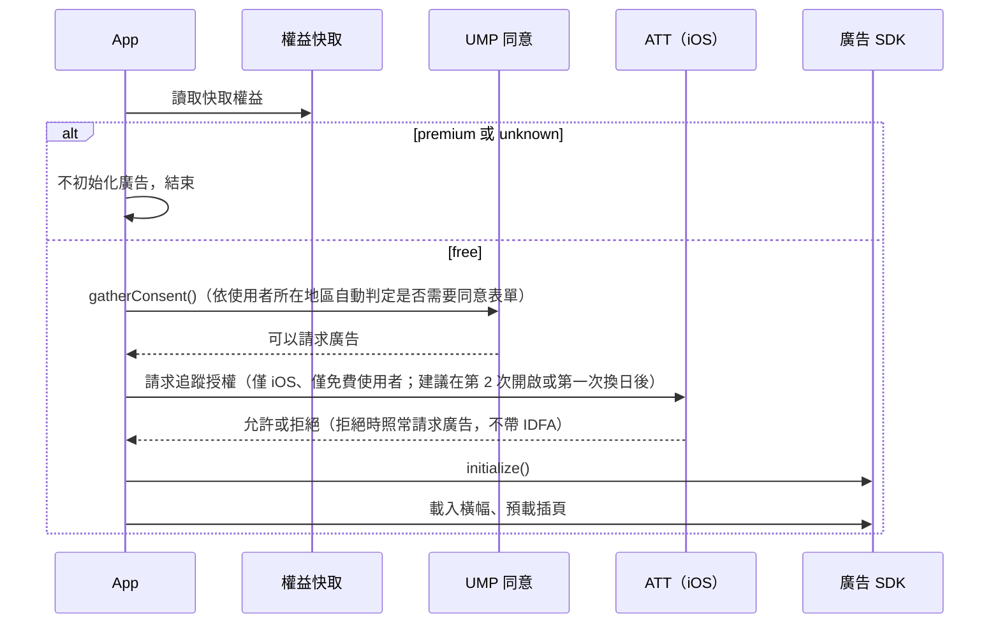

- 台灣使用者通常不會看到 UMP 同意表單（只有 EEA／UK／瑞士需要），但仍接 UMP：成本低、地區由 Google 判定、台灣帳號的人出國時也能自動合規。
- 設定頁提供「隱私選項」入口；只在 `getPrivacyOptionsRequirementStatus()` 回 REQUIRED 時顯示。
- ATT 說明頁可以先顯示（為什麼要授權），但不得把功能或獎勵綁在同意上（Apple 5.1.2(i)）。
- 權益從 `free` 變成 `premium`（購買、恢復、登入切換）時，執行 5.7.1 的卸載動作；從 `premium` 變回 `free`（到期）時，下次啟動才開始走本流程，不在使用中途突然出現廣告。

#### 5.7.5 遠端控制與申報

- `ads.enabled` 是伺服器總開關：關閉時 App 不初始化 SDK，用於廣告帳戶出問題或臨時活動。頻率參數見 7.3.16。
- 商店申報：Play 的「廣告」申報填「有」（商店頁會顯示「含廣告」標籤）、「廣告 ID」申報填「有」、Data safety 依 Google 的 GMA 揭露頁填；App Store 隱私標籤依 GMA privacy manifest 填。細節見 11.7。

### 5.8 筆記附件

#### 5.8.1 行為

- 入口在日檢視的筆記區下方：「附加」按鈕 → 選擇「相簿」（expo-image-picker，照片與影片）或「檔案」（expo-document-picker，PDF 等文件；選取後仍受副檔名白名單限制）。
- 選取後依 `/config` 回傳的方案限制檢查三件事：副檔名在白名單內、當天附件數未達上限、單檔大小未超過上限。任一項不符時顯示說明（例如「免費版每天可附加 1 張 JPEG／PNG 照片」）與「訂閱解鎖」入口，不是硬性錯誤畫面。
- 副檔名以檔名的副檔名為準、MIME 類型為輔；兩者矛盾時以較嚴格者計。白名單比對不分大小寫。
- 附件顯示在筆記下方的縮圖列：圖片直接顯示，影片顯示第一格與播放圖示（expo-video 播放），其他檔案顯示副檔名圖示，點擊以系統「開啟方式」開啟（expo-sharing）。
- 月曆：有附件的日期在筆記圓點旁加一個小標記，與筆記標記共用同一次 multiGet 讀取。
- 小工具與分享卡片不使用附件。

#### 5.8.2 儲存

- 檔案存在 App 文件目錄 `attachments/YYYYMMDD/<uuid>.<ext>`；圖片另存一張長邊 300 px 的縮圖供列表使用。
- 索引存 AsyncStorage `attachments:YYYYMMDD`，值為 JSON 陣列：`{ id, fileName, ext, mimeType, bytes, width?, height?, createdAt }`。
- 與筆記相同只存本機、不上傳；移除 App 即遺失。筆記雲端備份（APP-15）實作時一併涵蓋附件。
- 設定頁顯示附件總用量，並可依月份清除。

#### 5.8.3 方案限制（建議值，Q-16）

| 參數 | 免費 | 訂閱 |
|---|---|---|
| 每天附件數 `*.attachment.maxPerDay` | 1 | 10 |
| 副檔名白名單 `*.attachment.extensions` | jpg、jpeg、png | jpg、jpeg、png、heic、gif、webp、mp4、mov、pdf |
| 單檔大小 `*.attachment.maxBytes` | 5 MB | 50 MB |

訂閱到期後，超過免費限制的既有附件保留且可檢視，只是新增時回到免費限制。

### 5.9 貼圖

#### 5.9.1 貼圖包

- 貼圖包由後台上架（ADM-17）：代號、名稱、說明、封面、層級（免費／訂閱專屬）、一組透明背景 PNG（建議 512×512，單張 ≤ 200 KB，每包 ≤ 40 張）。
- 發佈時打包成 ZIP（`manifest.json` ＋ PNG），記錄版本號與 SHA-256；下載、驗證、解壓流程與 Skin 素材包相同（5.4.3）。
- 每張貼圖有穩定的代號（`Sticker.Code`），本機的貼圖位置資料用代號參照，貼圖包改版不會讓已貼的貼圖失效。
- 下架的貼圖包不在抽屜顯示新貼選項，但已貼的仍顯示（App 保留快取）。

#### 5.9.2 使用

- 日檢視的「貼圖」按鈕開啟貼圖抽屜，依貼圖包分頁；專屬包對未訂閱者顯示鎖頭，點擊開付費牆。
- 點選貼圖後貼到日檢視的畫布上：畫布是覆蓋在照片與筆記區上方的一層，支援拖曳、雙指縮放與旋轉、長按刪除（react-native-gesture-handler ＋ react-native-reanimated）。
- 每天最多 `sticker.maxPerDay`（預設 20）張。
- 位置資料存 AsyncStorage `stickers:YYYYMMDD`，JSON 陣列：`{ packCode, stickerCode, x, y, scale, rotation, z }`。`x`、`y` 以畫布寬高的比例（0～1）儲存，`scale` 以畫布寬度為基準，才能在不同螢幕尺寸與分享卡片上重現相同構圖。
- 分享卡片（5.10）使用同一份位置資料重繪貼圖。
- 小工具不顯示貼圖（v2.0）；Android 小工具可在之後把貼圖合成進圖片，列為後續項目。
- Skin 與貼圖彼此獨立：Skin 決定整體視覺，貼圖是使用者放置的裝飾。

### 5.10 分享卡片

- 內容：當日圖片、小語、出處、日期；可勾選是否加入筆記文字與貼圖。配色沿用目前的 Skin。
- 尺寸提供兩種：1080×1920（限時動態）與 1080×1080（方形貼文）。
- 產生方式：App 端以離屏 View 排版，用 react-native-view-shot（或等效方案）擷取成 PNG，再呼叫 expo-sharing 開系統分享面板，由使用者選擇 IG、LINE、儲存到相簿等。不經過伺服器。
- 免費版在右下角加 App 名稱浮水印（`share.watermark`）；訂閱者無浮水印。
- 鎖定日期不能分享（免費使用者只能分享今天）。
- 該日內容的「可分享」為否時（5.1.1），分享按鈕隱藏，並在日檢視顯示「此圖片不提供分享」。
- 版權：只有「可分享」為是的圖片才會被輸出；後台在授權說明旁提醒編輯確認圖片授權是否允許使用者再散布。

---

## 6. 訂閱與金流設計（App 內購）

> 本章的商店規定、函式庫版本與費率查證日期為 2026-10-26，來源列在第 11 章與各段落。商店政策常變動，上線前須再查一次。

### 6.1 原則

1. **全部走商店內購**：月訂閱與 Skin 都是「在 App 內解鎖功能或內容」，依 Apple 審核指南 3.1.1 與 Google Play 付款政策，台灣市場必須使用 App Store／Google Play 的內購。App 內不得串接綠界、藍新、TapPay，也不得放任何導向外部購買的按鈕、連結或文字（理由見 11.1）。
2. **不碰付款資料**：卡號、扣款、退款都由商店處理；後端只同步「誰擁有什麼、到什麼時候」。
3. **伺服器權益表是內容授權依據**：內容 API 與 Skin 下載都查本系統的 Entitlement 表（7.3.13），不採信 App 自報。
4. **事件只是「該重新同步」的訊號**：收到任何購買事件，一律向訂閱服務查詢該會員的最新完整狀態再寫入，不依事件內容逐筆增減，避免漏接或順序錯亂造成權益錯誤。

### 6.2 商品設計

| 項目 | App Store | Google Play | RevenueCat |
|---|---|---|---|
| 月訂閱 | 自動續訂訂閱，放在單一訂閱群組 `premium`，商品代號 `premium_monthly` | 訂閱 `premium`，基本方案 `monthly`（自動續訂、每月） | 權益 `premium`；Offering `default` 內放月訂閱方案 |
| 定價（D-09） | 月費 NT$100。Apple 每種貨幣有 800 個價格級距；依 Apple 2022-12 價格表，TWD 在 NT$10～500 區間以 NT$5 為一級，NT$100 是合法級距（鄰近：90、95、105、110）。上架時在 App Store Connect 或 pricePoints API（territory＝TWN）確認 | 月費 NT$100。Play 的 TWD 可設定範圍 NT$2～33,000（2026-01 版）。台灣是含稅國家，要「單獨設定台灣價格」並看含稅預覽，確認買家看到的是 NT$100 | 價格由商店決定，RevenueCat 只讀取 |
| 顯示價與稅 | 顯示價含 5% 營業稅，Apple 代收代繳；分潤以扣除營業稅後的金額計算 | 顯示價含 5% 營業稅，Google 代收代繳 | — |
| 免費試用（D-05，建議 7 天） | 訂閱群組的推出優惠（introductory offer），每群組一個 | 掛在基本方案上的優惠（offer），可設資格條件 | 自動帶出 |
| Skin | 每款一個非消耗型商品，代號 `skin_<code>` | 每款一個一次性商品，代號 `skin_<code>`；確認購買（acknowledge），永不消耗 | 匯入兩邊商品；後端依商品代號對應 Skin |
| 寬限期 | 需自行開啟，可選 3／16／28 天；建議 16 天 | 預設開啟，可調整 | 寬限期內權益維持有效 |
| 扣款失敗重試 | Apple 最多重試 60 天 | 寬限期後進入帳戶保留（預設 60 天減寬限期），保留期間須停止權益 | 反映在到期時間與帳單問題欄位 |
| 家人共享 | 自動續訂與非消耗型皆可開啟，**一旦開啟無法關閉**，須處理撤銷通知 | 一次性商品不可家人共享 | 不開啟（D-06） |

補充規定：

- Apple 訂閱週期至少 7 天，且必須在使用者所有裝置上都能使用（3.1.2(a)）。
- Google 新購買必須在 3 天內確認，否則自動退款；RevenueCat SDK 會自動處理確認。
- Google 自 2026-08-31 起要求新 App 與更新使用 Play Billing Library 8 以上，所選 SDK 版本須符合。
- 價格由商店的價格級距決定；App 顯示的價格一律取自商店 SDK 回傳的在地化字串，後端與 App 都不寫死金額。

### 6.3 訂閱管理方式：RevenueCat 或自建

| 比較 | RevenueCat（建議） | 自建（expo-iap ＋ 自行驗證） |
|---|---|---|
| App 端套件 | `react-native-purchases`（付費牆可選用 `react-native-purchases-ui`），npm 最新 10.15.1（2026-10-22） | `expo-iap` 6.3.0（2026-10-25），內含 config plugin |
| Expo 官方文件 | 「Using in-app purchases」列出的兩個選項之一 | 同左 |
| 開發版 | 必須（Expo Go 只有模擬模式） | 必須（不支援 Expo Go） |
| Apple 驗證 | RevenueCat 處理 | 自行串 App Store Server API ＋ Server Notifications V2；Apple 官方函式庫沒有 .NET 版，需自行實作 ES256 JWT 與 JWS 憑證鏈驗證 |
| Google 驗證 | RevenueCat 處理 | 自行串 Cloud Pub/Sub 即時通知（RTDN）＋ `purchases.subscriptionsv2.get`／`productsv2`；可用 NuGet `Google.Apis.AndroidPublisher.v3` |
| 跨平台權益 | 同一使用者 ID 自動合併 | 自行合併 |
| 費用 | 每月追蹤營收 US$2,500 以內免費，超過部分收 1% | 無服務費，但開發與維護成本高 |
| 後端串接 | Webhook ＋ REST API | 兩家商店各一套 |

建議採用 RevenueCat：一個人維護兩家商店的驗證、續訂、退款、帳單重試，成本遠高於 1% 的費用；營收規模變大後若要省費用，可再評估改為自建（資料表設計已與 RevenueCat 解耦）。列為 Q-14 待確認。

> 相容性提醒：RevenueCat 與 expo-iap 的文件都沒有明確寫出支援 Expo SDK 58／React Native 0.88（目前驗證到 RN 0.86～0.87），第 0 階段必須先在開發版實測。

### 6.4 App 端購買流程

1. 取得本系統會員 ID 後，以該 ID 作為 RevenueCat 的 `appUserID` 初始化 SDK（不使用 RevenueCat 匿名 ID）。
2. 付費牆透過 SDK 取得 Offering（方案、在地化價格、試用資訊）。
3. 使用者購買 → SDK 走商店流程 → 回傳最新購買資訊。
4. App 立即呼叫 `POST /me/purchases/sync`，伺服器向 RevenueCat 查詢並寫入權益後回傳 `/me` 結果。App 以伺服器結果為準更新權益快取，並重新同步內容（可看範圍變了）。
5. 若第 4 步失敗（網路問題），App 先依 SDK 回傳的購買資訊暫時解鎖畫面，並在下次啟動時重試同步；內容 API 仍以伺服器為準。

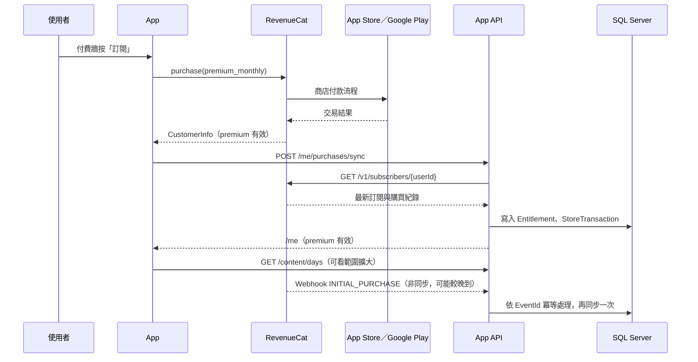

### 6.5 後端同步設計

**Webhook 接收（`POST /webhooks/revenuecat`）**

1. 驗證 RevenueCat 後台設定的 Authorization 標頭；若啟用 HMAC-SHA256 簽章則一併驗證。驗證失敗回 401。
2. 以事件 ID 寫入 WebhookEvent（唯一索引擋重複），立即回 200。RevenueCat 失敗時會重試 5 次，約 80 分鐘內。
3. 背景工作取出待處理事件 → 呼叫 RevenueCat REST API 查詢該會員最新狀態 → 寫入權益與交易 → 標記成功；失敗則累加重試次數，超過上限告警。

**同步規則（GET subscriber 結果 → 本系統資料）**

| 來源資料 | 寫入 | 規則 |
|---|---|---|
| `premium` 權益與其到期時間 | Entitlement（Type＝訂閱） | 依序判斷：到期時間晚於現在且無帳單問題＝有效；到期時間晚於現在且有帳單問題＝寬限期（寬限期內 RevenueCat 會延長到期時間）；其餘＝已過期 |
| 訂閱的期間類型（`period_type`） | Entitlement.IsTrial | `trial`＝1，其餘＝0 |
| 訂閱的帳單問題時間（`billing_issues_detected_at`） | Entitlement.BillingIssueAtUtc | 照填；補扣成功後 RevenueCat 會清空，同步時一併清空 |
| 訂閱的取消續訂時間 | Entitlement.WillRenew | 有值＝不再續訂（到期前仍有效） |
| 訂閱的退款時間 | Entitlement.Status＝已撤銷；StoreTransaction.RefundedAtUtc | 立即失去權益 |
| 非訂閱購買（依商品代號） | Entitlement（Type＝Skin） | 商品代號對應 Skin.AppleProductId／GoogleProductId；購買紀錄消失或已退款＝已撤銷 |
| 各筆交易 | StoreTransaction | 依（Store, TransactionId）upsert；記錄 Sandbox／Production |

> 欄位名稱（例如 `expires_date`、`period_type`、`unsubscribe_detected_at`、`billing_issues_detected_at`、`refunded_at`、`non_subscriptions`）與寬限期內到期時間的行為，以 RevenueCat REST API 文件為準，實作時對照。
>
> 同步只覆寫 Source 為 App Store、Google Play 的權益列；後台贈送與活動（Source 3、4）的列由後台管理，同步不碰。`/me` 與內容 API 判斷權益時，任一來源的列有效即算有權益。

**同步觸發點**

| 觸發 | 時機 |
|---|---|
| Webhook | 任何購買、續訂、取消、到期、帳單問題、退款、轉移事件 |
| App 主動 | 購買或恢復購買後呼叫 `POST /me/purchases/sync` |
| 每日對帳 | 排程工作每天針對：過去 24 小時內到期或將在 24 小時內到期的訂閱、處理失敗的事件、有交易但沒有權益紀錄的會員，重新同步 |

**Sandbox 交易**：商店審核人員會在正式版 App 上用 Sandbox 帳號測試購買，所以正式環境後端也必須接受 Sandbox 交易並授予權益。交易標記 Environment＝Sandbox，報表一律排除。

### 6.6 訂閱狀態

```mermaid
stateDiagram-v2
  [*] --> 未訂閱
  未訂閱 --> 試用中: 開始免費試用
  未訂閱 --> 有效: 購買
  試用中 --> 有效: 試用結束扣款成功
  試用中 --> 已取消續訂: 試用中關閉自動續訂
  有效 --> 有效: 續訂成功
  有效 --> 已取消續訂: 關閉自動續訂
  已取消續訂 --> 有效: 重新開啟自動續訂
  已取消續訂 --> 已過期: 期滿
  有效 --> 寬限期: 續訂扣款失敗
  寬限期 --> 有效: 補扣成功
  寬限期 --> 帳單保留: 寬限期結束仍失敗
  帳單保留 --> 有效: 補扣成功
  帳單保留 --> 已過期: 重試期滿
  有效 --> 已撤銷: 退款
  已過期 --> 有效: 重新訂閱
  已撤銷 --> 有效: 重新訂閱
```

| 狀態 | 有訂閱權益 | Entitlement.Status | App 顯示 |
|---|---|---|---|
| 試用中 | ✓ | 有效（IsTrial＝1） | 設定頁顯示「試用至 MM/DD」 |
| 有效 | ✓ | 有效 | 「訂閱中，下次續訂 MM/DD」 |
| 已取消續訂 | ✓（至期滿） | 有效（WillRenew＝0） | 「將於 MM/DD 到期」＋「重新訂閱」 |
| 寬限期 | ✓ | 寬限期 | 提示「付款失敗，請更新付款方式」，連到商店訂閱管理頁 |
| 帳單保留 | ✗ | 已過期（記錄帳單問題時間） | 同上，內容回到免費範圍 |
| 已過期 | ✗ | 已過期 | 付費牆 |
| 已撤銷 | ✗ | 已撤銷 | 付費牆；若正在用付費 Skin 也一併檢查 |

Skin 的狀態只有「擁有」與「已撤銷（退款）」兩種，不會到期。

### 6.7 特殊情境

| 情境 | 處理 |
|---|---|
| 恢復購買 | 設定頁與付費牆都有「恢復購買」按鈕 → SDK `restorePurchases` → `POST /me/purchases/sync` |
| 重裝 App 或換新手機（同平台） | 新的安裝 ID 會建立新的匿名會員；使用者按「恢復購買」時，RevenueCat 依專案的還原行為設定把購買轉到目前的使用者 ID，觸發轉移事件，後端同步新舊兩個會員。還原行為設定需在 RevenueCat 後台確認，建議用「轉移到新使用者 ID」 |
| 跨平台（iOS 買、Android 用） | 需要登入（APP-10，P1）讓兩邊使用同一個會員 ID。Apple 3.1.3(b) 允許在 App 內使用其他平台購買的內容，前提是同樣的商品在 App 內也能以內購購買 |
| 退款 | 商店退款 → Webhook → 同步後權益標為已撤銷；Skin 被撤銷時 App 切回預設 Skin |
| 刪除帳號 | 刪除帳號不會取消商店訂閱；刪除前提示使用者到商店取消，並提供商店訂閱管理頁連結 |
| 訂閱權益到期但 App 離線 | App 依本機快取的到期時間＋3 天寬限判斷（10.2），連線後以伺服器為準 |
| 後台手動贈送（ADM-12） | 只寫入本系統 Entitlement（Source＝後台贈送，需填原因與期限），不經過 RevenueCat；與商店來源的列分開存放，同步不覆寫；`/me` 合併計算 |

### 6.8 付費牆內容

付費牆必須包含（Apple 3.1.2 與第 11 章的消保建議）：

1. 訂閱名稱、週期（每月）、完整續訂價格（取自商店）；有試用時寫明試用期與試用結束後的扣款金額與日期。
2. 「自動續訂，可隨時於 App Store／Google Play 訂閱設定中取消」的說明。
3. 「恢復購買」按鈕。
4. 使用條款（EULA）與隱私權政策連結。
5. 數位內容的事先同意說明（11.3），文字放在購買按鈕附近，不能只寫在條款裡。
6. 訂閱可解鎖項目的清單（去廣告、完整歷史與未來內容、附件放寬、專屬貼圖、無浮水印分享；依 3.3 的權益表，從 `/config` 取得，避免與參數不一致）。
7. 付費牆頁面本身與購買流程中不顯示任何廣告。

可選用 RevenueCat Paywalls（`react-native-purchases-ui`），在 RevenueCat 後台調整版面而不用發版；或自製頁面以配合 Skin 風格。建議第一版先用 RevenueCat Paywalls。

### 6.9 營收與報表

- 訂閱數、MRR、試用轉換、流失率：直接使用 RevenueCat 儀表板。
- 後台報表（ADM-16）只做 RevenueCat 沒有的部分：各 Skin 銷售數、Skin 購買者中的訂閱比例、內容瀏覽統計。
- 後端交易紀錄的金額是使用者付款金額，不是實收金額（實收需扣商店抽成與稅），會計以商店的付款報表為準。
- 每月每位訂閱者的實收推算（非官方數字）：NT$100 含稅 → 未稅約 NT$95.2 → 扣 15% 抽成（Apple 小型企業方案／Google 訂閱費率）→ 約 NT$81。匯率、商店手續與銀行費用另計。

---

## 7. 資料庫設計

### 7.1 慣例

- 時間欄位一律存 UTC，型別 `DATETIME2(3)`，欄位名以 `Utc` 結尾；日曆日期用 `DATE`。
- 主鍵：對外會出現的實體（會員、素材）用 `UNIQUEIDENTIFIER`，其餘用 `INT`／`BIGINT IDENTITY`。
- 列舉存 `TINYINT`，對照表寫在本章與程式列舉中。
- 需要並行控制的表加 `RowVersion ROWVERSION`（後台多人同時編輯）。
- 文字一律 `NVARCHAR`；代號類（商品代號、Skin 代號）用 `VARCHAR`。
- 每張表對應一個 `{表名}Model` 與一個 `{表名}Dao`；表名採單數，DAO 建構時明確傳入表名（4.6.3）。結構變更一律寫成新的 DbUp 腳本，不修改已執行過的腳本。

### 7.2 ER 圖

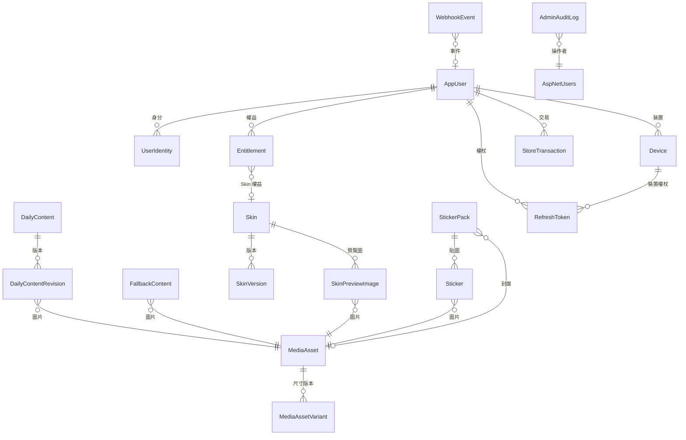

### 7.3 資料表規格

#### 7.3.1 DailyContent（每日內容）

| 欄位 | 型別 | 空值 | 說明 |
|---|---|---|---|
| Id | INT IDENTITY | N | PK |
| ContentDate | DATE | N | 日期 |
| Locale | VARCHAR(10) | N | 預設 `zh-TW` |
| Status | TINYINT | N | 0 草稿、1 已發佈、2 已下架 |
| PublishedRevisionId | INT | Y | 目前上線版本（FK DailyContentRevision） |
| CreatedAtUtc／UpdatedAtUtc | DATETIME2(3) | N | |
| RowVersion | ROWVERSION | N | |

唯一索引：(ContentDate, Locale)。

#### 7.3.2 DailyContentRevision（內容版本）

| 欄位 | 型別 | 空值 | 說明 |
|---|---|---|---|
| Id | INT IDENTITY | N | PK |
| DailyContentId | INT | N | FK |
| RevisionNo | INT | N | 該日第幾版，對 App 公開為 `version` |
| QuoteText | NVARCHAR(300) | N | 小語 |
| QuoteSource | NVARCHAR(100) | Y | 出處 |
| ImageAssetId | UNIQUEIDENTIFIER | N | FK MediaAsset |
| LicenseInfo | NVARCHAR(300) | N | 授權說明 |
| ShareAllowed | BIT | N | 是否允許分享卡片輸出（5.10），預設 1 |
| EditorNote | NVARCHAR(500) | Y | 編輯備註 |
| EffectiveAtUtc | DATETIME2(3) | Y | 排程生效時間；空值＝立即 |
| AppliedAtUtc | DATETIME2(3) | Y | 實際成為上線版本的時間 |
| CreatedBy | NVARCHAR(450) | N | 後台使用者 Id |
| CreatedAtUtc | DATETIME2(3) | N | |

唯一索引：(DailyContentId, RevisionNo)。索引：(EffectiveAtUtc) WHERE AppliedAtUtc IS NULL（排程工作用）。

#### 7.3.3 FallbackContent（備援內容）

| 欄位 | 型別 | 空值 | 說明 |
|---|---|---|---|
| Id | INT IDENTITY | N | PK |
| QuoteText | NVARCHAR(300) | N | |
| QuoteSource | NVARCHAR(100) | Y | |
| ImageAssetId | UNIQUEIDENTIFIER | N | FK MediaAsset |
| LicenseInfo | NVARCHAR(300) | N | 授權說明 |
| ShareAllowed | BIT | N | 是否允許分享卡片輸出（5.10）；預設 0，備援圖通常不開放分享 |
| IsActive | BIT | N | 多筆啟用時依日期輪替 |
| SortOrder | INT | N | |

#### 7.3.4 MediaAsset（素材）

| 欄位 | 型別 | 空值 | 說明 |
|---|---|---|---|
| Id | UNIQUEIDENTIFIER | N | PK，也用於物件鍵 |
| Kind | TINYINT | N | 1 每日圖片、2 Skin 預覽、3 Skin 素材、4 貼圖、5 貼圖包封面 |
| OriginalStorageKey | VARCHAR(300) | N | 原圖物件鍵（不公開） |
| OriginalFileName | NVARCHAR(260) | N | |
| ContentType | VARCHAR(50) | N | |
| Width／Height | INT | N | 原圖尺寸 |
| Bytes | BIGINT | N | |
| Sha256 | CHAR(64) | N | 重複上傳偵測 |
| BlurHash | VARCHAR(60) | Y | |
| UploadedBy | NVARCHAR(450) | N | |
| UploadedAtUtc | DATETIME2(3) | N | |

#### 7.3.5 MediaAssetVariant（尺寸版本）

| 欄位 | 型別 | 空值 | 說明 |
|---|---|---|---|
| AssetId | UNIQUEIDENTIFIER | N | PK1，FK |
| Variant | VARCHAR(20) | N | PK2：`full`、`widget`、`thumb` |
| StorageKey | VARCHAR(300) | N | |
| Width／Height | INT | N | |
| Bytes | BIGINT | N | |

#### 7.3.6 Skin

| 欄位 | 型別 | 空值 | 說明 |
|---|---|---|---|
| Id | INT IDENTITY | N | PK |
| Code | VARCHAR(50) | N | 唯一，例如 `sakura` |
| Name | NVARCHAR(50) | N | |
| Description | NVARCHAR(500) | Y | |
| IsFree | BIT | N | 免費 Skin 不需商品代號 |
| IsDefault | BIT | N | 只能有一筆 |
| AppleProductId | VARCHAR(100) | Y | App Store 商品代號 |
| GoogleProductId | VARCHAR(100) | Y | Google Play 商品代號 |
| Status | TINYINT | N | 0 草稿、1 上架、2 下架 |
| SortOrder | INT | N | |
| CurrentVersionId | INT | Y | FK SkinVersion |
| CreatedAtUtc／UpdatedAtUtc | DATETIME2(3) | N | |
| RowVersion | ROWVERSION | N | |

下架的 Skin 不在商店顯示，但已購買者仍可下載與套用。

#### 7.3.7 SkinVersion（Skin 版本）

| 欄位 | 型別 | 空值 | 說明 |
|---|---|---|---|
| Id | INT IDENTITY | N | PK |
| SkinId | INT | N | FK |
| VersionNo | INT | N | |
| SchemaVersion | INT | N | token 結構版本（附錄 A） |
| TokensJson | NVARCHAR(MAX) | N | `skin.json` 內容 |
| PackageStorageKey | VARCHAR(300) | Y | 素材包；預設 Skin 可為空 |
| PackageSha256 | CHAR(64) | Y | |
| PackageBytes | BIGINT | Y | |
| MinAppVersion | VARCHAR(20) | N | 例如 `2.0.0` |
| CreatedBy | NVARCHAR(450) | N | |
| CreatedAtUtc | DATETIME2(3) | N | |

#### 7.3.8 SkinPreviewImage（Skin 預覽圖）

| 欄位 | 型別 | 空值 | 說明 |
|---|---|---|---|
| SkinId | INT | N | PK1 |
| AssetId | UNIQUEIDENTIFIER | N | PK2 |
| SortOrder | INT | N | |

#### 7.3.9 AppUser（會員）

| 欄位 | 型別 | 空值 | 說明 |
|---|---|---|---|
| Id | UNIQUEIDENTIFIER | N | PK；同時作為 RevenueCat 使用者 ID |
| Status | TINYINT | N | 0 正常、1 停用、2 已刪除 |
| CreatedAtUtc | DATETIME2(3) | N | |
| LastSeenAtUtc | DATETIME2(3) | N | |
| DeletedAtUtc | DATETIME2(3) | Y | |

#### 7.3.10 UserIdentity（身分）

| 欄位 | 型別 | 空值 | 說明 |
|---|---|---|---|
| Id | INT IDENTITY | N | PK |
| UserId | UNIQUEIDENTIFIER | N | FK |
| Provider | VARCHAR(20) | N | `install`、`apple`、`google` |
| Subject | NVARCHAR(200) | N | 安裝 ID 或第三方使用者識別碼 |
| Email | NVARCHAR(256) | Y | 第三方登入提供時才有（Apple 可能是轉寄信箱） |
| CreatedAtUtc | DATETIME2(3) | N | |

唯一索引：(Provider, Subject)。

#### 7.3.11 Device（裝置）

| 欄位 | 型別 | 空值 | 說明 |
|---|---|---|---|
| Id | INT IDENTITY | N | PK |
| UserId | UNIQUEIDENTIFIER | N | FK |
| InstallId | UNIQUEIDENTIFIER | N | 唯一 |
| Platform | VARCHAR(10) | N | `ios`、`android` |
| AppVersion | VARCHAR(20) | N | |
| OsVersion | VARCHAR(20) | Y | |
| PushToken | VARCHAR(200) | Y | P2 推播用 |
| LastSeenAtUtc | DATETIME2(3) | N | |

#### 7.3.12 RefreshToken（更新權杖）

| 欄位 | 型別 | 空值 | 說明 |
|---|---|---|---|
| Id | BIGINT IDENTITY | N | PK |
| UserId | UNIQUEIDENTIFIER | N | FK |
| DeviceId | INT | N | FK |
| TokenHash | CHAR(64) | N | 只存雜湊；唯一 |
| ExpiresAtUtc | DATETIME2(3) | N | |
| RevokedAtUtc | DATETIME2(3) | Y | |
| ReplacedById | BIGINT | Y | 輪替鏈，偵測重複使用 |

#### 7.3.13 Entitlement（權益，現況表）

| 欄位 | 型別 | 空值 | 說明 |
|---|---|---|---|
| Id | BIGINT IDENTITY | N | PK |
| UserId | UNIQUEIDENTIFIER | N | FK |
| Type | TINYINT | N | 1 訂閱（premium）、2 Skin |
| SkinId | INT | Y | Type＝2 時必填 |
| Source | TINYINT | N | 1 App Store、2 Google Play、3 後台贈送、4 活動 |
| Status | TINYINT | N | 0 有效、1 寬限期、2 已過期、3 已撤銷 |
| StartsAtUtc | DATETIME2(3) | N | |
| ExpiresAtUtc | DATETIME2(3) | Y | Skin 為空（永久） |
| WillRenew | BIT | Y | 訂閱是否會自動續訂 |
| IsTrial | BIT | N | 是否為免費試用期間 |
| BillingIssueAtUtc | DATETIME2(3) | Y | 偵測到扣款失敗的時間（寬限期與帳單保留判斷用） |
| StoreProductId | VARCHAR(100) | Y | |
| OriginalTransactionId | VARCHAR(100) | Y | |
| GrantReason | NVARCHAR(200) | Y | 後台贈送時必填 |
| LastSyncedAtUtc | DATETIME2(3) | N | 最後一次與 RevenueCat 同步時間 |

唯一索引：(UserId, Type, SkinId, Source)（SkinId 為空時以篩選索引處理訂閱唯一）。同一會員可同時有商店來源與後台贈送兩筆訂閱權益，例如已訂閱者又獲客服補償；判斷權益時任一筆有效即可（6.5）。這張表只放「現在的狀態」，歷史在 StoreTransaction 與 WebhookEvent。

#### 7.3.14 StoreTransaction（商店交易）

| 欄位 | 型別 | 空值 | 說明 |
|---|---|---|---|
| Id | BIGINT IDENTITY | N | PK |
| UserId | UNIQUEIDENTIFIER | N | FK |
| Store | TINYINT | N | 1 App Store、2 Google Play |
| ProductId | VARCHAR(100) | N | |
| ProductType | TINYINT | N | 1 自動續訂、2 非消耗型 |
| TransactionId | VARCHAR(100) | N | |
| OriginalTransactionId | VARCHAR(100) | Y | |
| PurchasedAtUtc | DATETIME2(3) | N | |
| ExpiresAtUtc | DATETIME2(3) | Y | |
| Price | DECIMAL(12,2) | Y | 使用者付款金額（在地幣別） |
| Currency | CHAR(3) | Y | |
| Environment | TINYINT | N | 1 Sandbox、2 Production |
| RefundedAtUtc | DATETIME2(3) | Y | |
| RawJson | NVARCHAR(MAX) | Y | 同步來源原始資料 |

唯一索引：(Store, TransactionId)。

#### 7.3.15 WebhookEvent（事件收件匣）

| 欄位 | 型別 | 空值 | 說明 |
|---|---|---|---|
| Id | BIGINT IDENTITY | N | PK |
| Provider | VARCHAR(20) | N | `revenuecat` |
| EventId | VARCHAR(100) | N | 唯一（冪等） |
| EventType | VARCHAR(50) | N | |
| AppUserId | UNIQUEIDENTIFIER | Y | |
| ReceivedAtUtc | DATETIME2(3) | N | |
| Status | TINYINT | N | 0 待處理、1 成功、2 失敗、3 略過 |
| RetryCount | INT | N | |
| LastError | NVARCHAR(1000) | Y | |
| ProcessedAtUtc | DATETIME2(3) | Y | |
| PayloadJson | NVARCHAR(MAX) | N | |

#### 7.3.16 AppSetting（系統參數）

| 欄位 | 型別 | 空值 | 說明 |
|---|---|---|---|
| Key | VARCHAR(100) | N | PK |
| Value | NVARCHAR(MAX) | N | JSON 值 |
| Description | NVARCHAR(300) | N | |
| UpdatedBy | NVARCHAR(450) | N | |
| UpdatedAtUtc | DATETIME2(3) | N | |

初始參數：

| Key | 預設值 | 說明 |
|---|---|---|
| `free.pastDays` | `0` | 免費版可看過去幾天 |
| `free.widgetEnabled` | `true` | 免費版能否使用小工具（D-04） |
| `premium.previewDays` | `31` | 訂閱者可預看未來幾天 |
| `content.gapAlertDays` | `30` | 缺漏警示天數 |
| `app.minVersion.ios`／`app.minVersion.android` | `2.0.0` | 最低 App 版本 |
| `app.announcement` | `null` | 公告（標題、內文、起訖時間） |
| `app.maintenance` | `false` | 維護模式 |
| `ads.enabled` | `true` | 免費版是否顯示廣告（D-08） |
| `ads.interstitialMinIntervalMinutes` | `10` | 兩次插頁廣告的最短間隔 |
| `ads.interstitialMinActions` | `8` | 兩次插頁之間至少幾次換日／換月操作 |
| `free.attachment.maxPerDay` | `1` | 免費版每天附件數上限 |
| `free.attachment.extensions` | `["jpg","jpeg","png"]` | 免費版允許的副檔名 |
| `free.attachment.maxBytes` | `5242880` | 免費版單檔大小上限（5 MB） |
| `premium.attachment.maxPerDay` | `10` | 訂閱者每天附件數上限 |
| `premium.attachment.extensions` | `["jpg","jpeg","png","heic","gif","webp","mp4","mov","pdf"]` | 訂閱者允許的副檔名 |
| `premium.attachment.maxBytes` | `52428800` | 訂閱者單檔大小上限（50 MB） |
| `sticker.maxPerDay` | `20` | 每天可貼的貼圖數上限 |
| `share.watermark` | `true` | 免費版分享卡片是否加浮水印 |
| `premium.features` | 見 6.8 | 付費牆顯示的訂閱權益清單（文字） |

#### 7.3.17 後台帳號與稽核

- 後台帳號使用 ASP.NET Core Identity 的標準資料表（AspNetUsers、AspNetRoles、AspNetUserRoles 等），角色名稱對應 3.2。
- AdminAuditLog：Id（BIGINT）、AdminUserId、Action、EntityType、EntityId、BeforeJson、AfterJson、IpAddress、AtUtc。只新增，不提供修改與刪除。

#### 7.3.18 StickerPack（貼圖包）

| 欄位 | 型別 | 空值 | 說明 |
|---|---|---|---|
| Id | INT IDENTITY | N | PK |
| Code | VARCHAR(50) | N | 唯一，例如 `daily-basic` |
| Name | NVARCHAR(50) | N | |
| Description | NVARCHAR(300) | Y | |
| Tier | TINYINT | N | 0 免費、1 訂閱專屬 |
| Status | TINYINT | N | 0 草稿、1 上架、2 下架 |
| SortOrder | INT | N | |
| CoverAssetId | UNIQUEIDENTIFIER | Y | FK MediaAsset（Kind＝5） |
| VersionNo | INT | N | 每次發佈遞增，App 以此判斷是否重新下載 |
| PackageStorageKey | VARCHAR(300) | Y | ZIP 物件鍵 |
| PackageSha256 | CHAR(64) | Y | |
| PackageBytes | BIGINT | Y | |
| MinAppVersion | VARCHAR(20) | N | |
| CreatedAtUtc／UpdatedAtUtc | DATETIME2(3) | N | |
| RowVersion | ROWVERSION | N | |

#### 7.3.19 Sticker（貼圖）

| 欄位 | 型別 | 空值 | 說明 |
|---|---|---|---|
| Id | INT IDENTITY | N | PK |
| StickerPackId | INT | N | FK |
| Code | VARCHAR(50) | N | 包內唯一；本機貼圖位置資料以此參照 |
| AssetId | UNIQUEIDENTIFIER | N | FK MediaAsset（Kind＝4） |
| SortOrder | INT | N | |

唯一索引：(StickerPackId, Code)。

### 7.4 資料保存

| 資料 | 保存期限 |
|---|---|
| 每日內容與版本 | 永久 |
| 未被引用的素材 | 由後台手動清理（列出 90 天未引用者） |
| WebhookEvent | 成功事件保存 400 天後清除 PayloadJson |
| StoreTransaction | 依稅務與會計需求保存（建議至少 7 年，待確認，見 Q-13） |
| 已刪除會員 | 立即刪除身分、裝置、權杖；交易紀錄去識別化保留 |
| 稽核紀錄 | 至少 2 年 |

---

## 8. API 設計

### 8.1 通則

| 項目 | 規則 |
|---|---|
| 基底路徑 | `https://api.<domain>/api/v1` |
| 格式 | JSON、camelCase、UTF-8 |
| 日期 | API 一律 `YYYY-MM-DD`；App 內部仍用 `YYYYMMDD` 鍵，在 API 用戶端轉換 |
| 時間 | ISO 8601 UTC，例如 `2026-11-05T01:23:45Z` |
| 驗證 | `Authorization: Bearer <accessToken>`；例外：`/config`、`/auth/anonymous`、`/auth/refresh`、`/auth/signin` 不需存取權杖，`/webhooks/revenuecat` 改用 RevenueCat 授權標頭 |
| 錯誤 | RFC 9457 ProblemDetails，含自訂 `code` 欄位（例如 `content.range_too_large`） |
| 快取 | 內容與目錄回應帶 `ETag`，支援 `If-None-Match` → 304 |
| 限流 | 依會員與 IP；匿名註冊另有較嚴格的 IP 限流 |
| 版本相容 | App 每次請求帶 `X-App-Version`、`X-Platform`；破壞性變更走 `/api/v2` |

### 8.2 App API

| 方法 | 路徑 | 說明 | 對應 |
|---|---|---|---|
| GET | `/config` | 免費與訂閱方案規則（含附件限制、貼圖上限、廣告設定、分享浮水印、權益清單文字）、最低版本、公告、維護模式 | APP-12 |
| POST | `/auth/anonymous` | 以安裝 ID 建立或取回匿名會員，回傳權杖 | SVC-01 |
| POST | `/auth/refresh` | 更新權杖（輪替） | SVC-01 |
| POST | `/auth/link` | 以 Apple／Google ID Token 把身分連結到目前會員；身分已屬其他會員時回 409 | APP-10 |
| POST | `/auth/signin` | 以 Apple／Google ID Token 登入該身分所屬的會員並回傳權杖（換機、或 `/auth/link` 回 409 後使用者同意切換時） | APP-10 |
| POST | `/auth/logout` | 撤銷本裝置更新權杖 | APP-10 |
| GET | `/content/days?from&to` | 區間內每日內容（依權益過濾） | SVC-02 |
| GET | `/skins` | Skin 目錄（含是否擁有） | SVC-03 |
| GET | `/skins/{code}` | Skin 詳情與目前版本 token | SVC-03 |
| GET | `/skins/{code}/package` | 取得素材包限時下載網址（免費或已擁有才可） | SVC-03 |
| GET | `/stickers` | 貼圖包目錄（含層級、版本號、是否可用） | SVC-09 |
| GET | `/stickers/{code}/package` | 取得貼圖包限時下載網址（免費包任何人；專屬包限訂閱者） | SVC-09 |
| GET | `/me` | 會員資訊與目前權益 | SVC-04 |
| POST | `/me/purchases/sync` | 購買或恢復後請伺服器立即重新同步 | SVC-05 |
| DELETE | `/me` | 刪除帳號 | SVC-08 |
| POST | `/webhooks/revenuecat` | RevenueCat 事件接收（不經 JWT，另有驗證） | SVC-05 |

上表每個端點都由 App API 的 Controller 接收、呼叫對應的 Facade（對照見 4.6.4）。管理後台是 ASP.NET Core MVC，同樣由 Controller 呼叫 Facade，不另外開放後台 API。

### 8.3 範例

**POST /auth/anonymous**

```json
// Request
{ "installId": "3f1b6c1e-8a0e-4c55-9a5f-1d2e3f4a5b6c", "platform": "ios", "appVersion": "2.0.0" }

// Response 200
{
  "userId": "b8d4e0f2-1c3a-4e5b-9d7f-0a1b2c3d4e5f",
  "accessToken": "eyJhbGciOi…",
  "accessTokenExpiresAt": "2026-11-05T02:23:45Z",
  "refreshToken": "rt_…"
}
```

**GET /content/days?from=2026-11-01&to=2026-11-30**

```json
{
  "from": "2026-11-01",
  "to": "2026-11-30",
  "tier": "free",
  "days": [
    {
      "date": "2026-11-05",
      "locked": false,
      "version": 3,
      "quote": { "text": "慢慢來，比較快。", "source": "佚名" },
      "image": {
        "width": 1290, "height": 1440,
        "blurHash": "LKO2?U%2Tw=w]~RBVZRi};RPxuwH",
        "full": "https://cdn.example.com/daily/7f3c…/full.jpg",
        "widget": "https://cdn.example.com/daily/7f3c…/widget.jpg",
        "thumb": "https://cdn.example.com/daily/7f3c…/thumb.jpg"
      },
      "isFallback": false,
      "shareAllowed": true
    },
    { "date": "2026-11-04", "locked": true, "blurHash": "L6PZfSi_.AyE_3t7t7R**0o#DgR4" }
  ]
}
```

規則：區間最多 62 天；`width`／`height` 為 `full` 版本的尺寸（App 用來算長寬比）；`shareAllowed` 取自該日上線版本，備援內容（`isFallback: true`）則取自 FallbackContent 的設定；未發佈且無備援的日期不出現在 `days`；`locked: true` 的項目只帶 BlurHash。

**GET /me**

```json
{
  "userId": "b8d4e0f2-…",
  "linkedProviders": ["apple"],
  "premium": { "active": true, "status": "active", "expiresAt": "2026-12-05T01:00:00Z", "willRenew": true, "store": "app_store" },
  "ownedSkins": ["sakura", "ink"]
}
```

### 8.4 主要錯誤碼

| HTTP | code | 情境 |
|---|---|---|
| 400 | `content.range_too_large` | 查詢區間超過 62 天 |
| 401 | `auth.token_expired` | 存取權杖過期，App 應更新權杖 |
| 401 | `auth.refresh_reused` | 更新權杖被重複使用，撤銷該裝置所有權杖 |
| 403 | `skin.not_owned` | 下載未擁有的 Skin 素材包 |
| 403 | `sticker.premium_required` | 下載訂閱專屬貼圖包但沒有訂閱權益 |
| 404 | `skin.not_found` | Skin 不存在或未上架且未擁有 |
| 409 | `auth.identity_in_use` | 要連結的 Apple／Google 身分已屬於其他會員 |
| 426 | `app.upgrade_required` | App 版本低於最低版本 |
| 503 | `app.maintenance` | 維護模式 |

---

## 9. 主要流程

### 9.1 App 啟動與內容同步

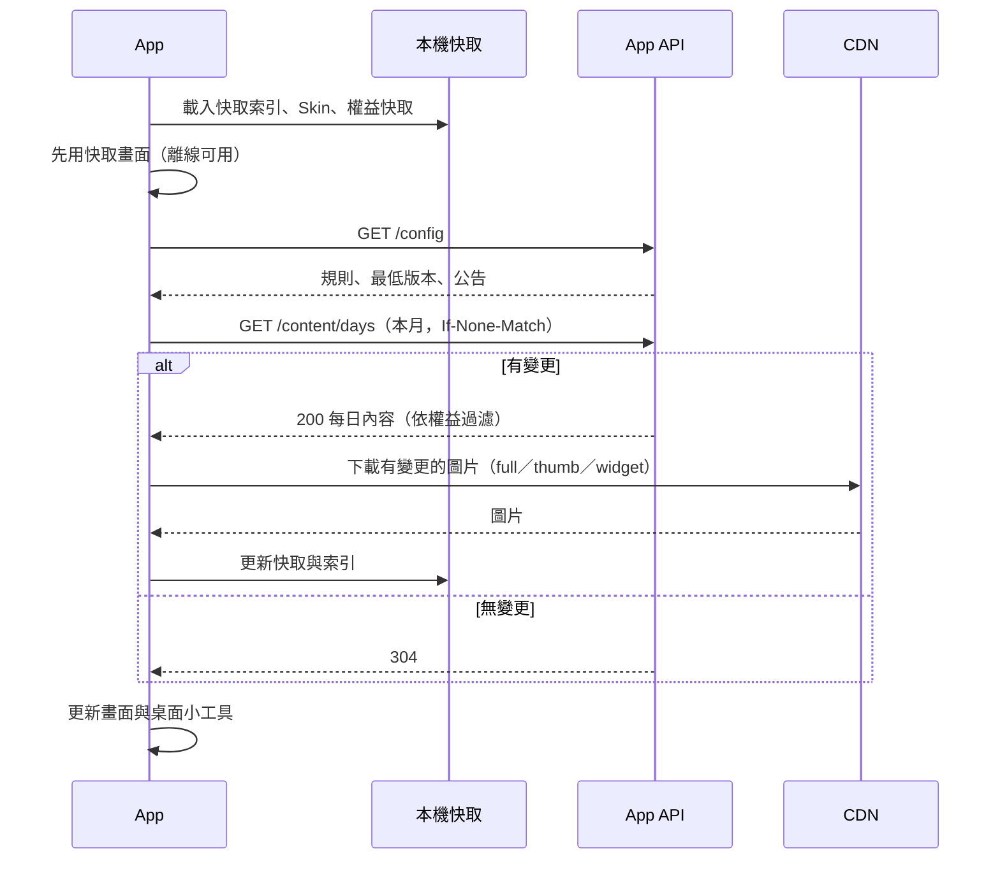

### 9.2 後台發佈與抽換

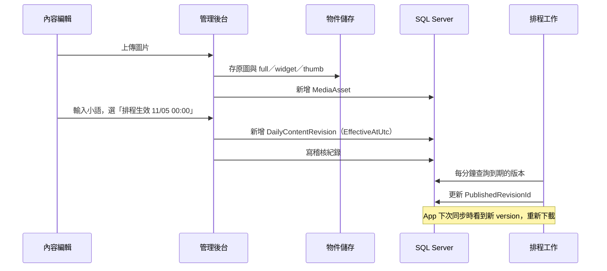

### 9.3 Skin 購買、下載與套用

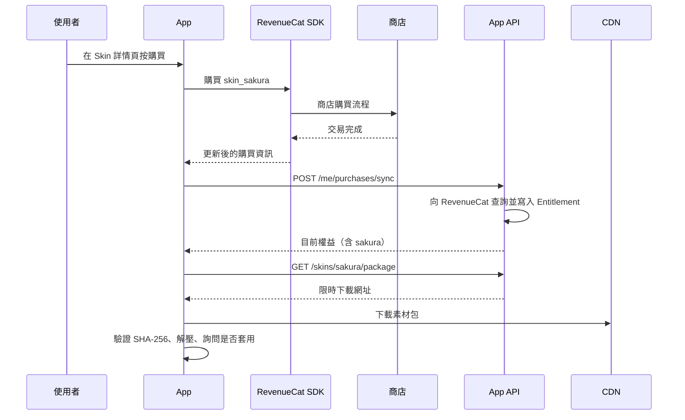

訂閱購買、恢復購買、到期與退款的流程見第 6 章。

### 9.4 桌面小工具更新

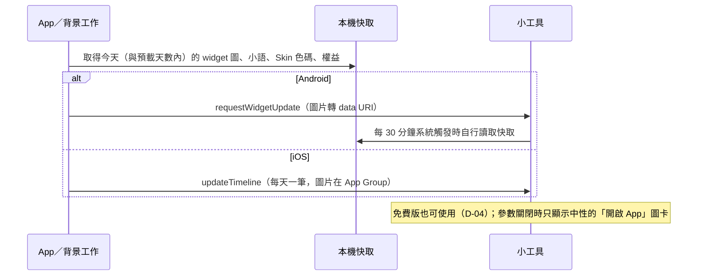

---

## 10. 安全、隱私與非功能需求

### 10.1 效能

| 項目 | 目標 |
|---|---|
| 內容 API 回應時間 | p95 < 300 ms（不含圖片） |
| 有快取時 App 首頁顯示 | < 1 秒 |
| 日檢視圖片（full） | 單張 ≤ 400 KB |
| 小工具圖片（widget） | 單張 ≤ 120 KB |
| 同時線上 | 第一年以 1 萬日活設計；圖片由 CDN 承擔，API 單機即可 |

### 10.2 可用性

- API 可用率目標 99.5%；API 停止時 App 仍能以快取運作，權益以本機快取為準（訂閱權益快取到 `expiresAt` 加 3 天寬限）。
- 資料庫每日完整備份＋交易記錄備份（或使用 Azure SQL 的時間點還原），每季演練還原一次。
- 物件儲存啟用版本控制或軟刪除。

### 10.3 安全

- 全程 HTTPS；HSTS。
- App 權杖：存取權杖 1 小時；更新權杖只存雜湊、每次使用即輪替，偵測重複使用時撤銷整條鏈。
- 匿名註冊限流；P2 評估 App Attest／Play Integrity 防濫用。
- Webhook：驗證 RevenueCat 設定的 Authorization 標頭（可加 HMAC-SHA256 簽章）；只接受 HTTPS；事件以 EventId 冪等處理；處理時不信任事件內容，改向 RevenueCat 主動查詢最新狀態（第 6 章）。
- 後台：雙因素必填、閒置 30 分鐘登出、登入失敗鎖定、可加 IP 白名單；所有寫入留稽核紀錄。
- 機密（資料庫連線、RevenueCat 金鑰、JWT 簽章金鑰、儲存體金鑰）放 Azure Key Vault 或環境變數，不進版本控制。
- 資料庫帳號最小權限：API 與後台使用不同帳號，皆不具 DDL 權限；遷移用另一個帳號。
- 上傳檔案檢查實際格式（不只看副檔名），重新編碼後才對外提供。

### 10.4 隱私

- 最少蒐集：匿名會員只有安裝 ID 與裝置資訊；第三方登入只存識別碼與（若提供）信箱。
- 第三方 SDK 蒐集的資料也要揭露：廣告 SDK（裝置識別碼、IP／大約位置、廣告互動、診斷）與 RevenueCat（購買紀錄、App 使用者 ID）。訂閱者不初始化廣告 SDK，所以這部分只適用免費使用者。
- 個資法對應：廣告 ID 加上 IP 很可能構成「間接識別」的個人資料（第 2 條）。隱私權政策依第 8 條列出告知事項：蒐集者名稱、目的、資料類別、利用的期間／地區／對象／方式、當事人依第 3 條的權利（查詢、閱覽、複製、補正、停止、刪除）、不提供的影響；依第 20 條提供拒絕行銷的方式；說明資料會傳輸到境外（美國，第 21 條）；外洩時依第 12 條通知。
- 退出方式要寫清楚：iOS 在系統「追蹤」設定關閉、Android 刪除廣告 ID、App 內設定頁的「隱私選項」（5.7.4）。
- 法規變動：個資法 2025-11-11 修正（主管機關改為個人資料保護委員會），部分條文尚未生效；數位發展部《數位經濟相關產業個人資料檔案安全維護管理辦法》是否適用本公司行業別，請法務確認。
- 筆記不上傳（v2.0）。
- App Store 隱私標籤與 Google Play 資料安全表單依實際蒐集項目填寫。
- 提供隱私權政策與使用條款網頁（App 內與商店頁皆可連到）。
- 刪除帳號流程：刪除身分、裝置、權杖、本機資料；交易紀錄去識別化後依法保留；告知使用者「刪除帳號不會取消商店訂閱，請到商店取消」。

### 10.5 相容性

- iOS／Android 最低版本依 Expo SDK 58 的支援範圍。
- 新版 App 必須能處理 API 新增欄位（忽略未知欄位）。
- Skin token 以 `schemaVersion` 控管；App 遇到不認得的版本使用預設 Skin。

### 10.6 維運與測試

- 結構化日誌，含請求 ID；錯誤與 Webhook 處理失敗觸發告警。
- 每日對帳工作（第 6 章）結果寫入日誌，有差異時告警。
- 後端：依分層各自測試，並以架構測試檢查不跳層（4.6.6）。
- App：內容層、權益層、Skin token 解析寫單元測試；商店流程以 Sandbox 帳號手動測試並留測試紀錄。
- App 送出前執行 `npx expo lint` 與 `npx tsc --noEmit`（AGENTS.md）。

---

## 11. 上架與法規注意事項

> 本章依 2026-10-26 查得的官方文件整理。「推論」表示文件沒有直接寫明、由條文推得；稅務與法律事項上線前請會計師或律師確認。

### 11.1 台灣市場的金流管道規定

| 項目 | App Store（台灣） | Google Play（台灣） |
|---|---|---|
| 訂閱與數位商品 | 必須用 IAP（審核指南 3.1.1） | 必須用 Play 結帳（付款政策） |
| App 內導向外部購買 | 禁止。外部購買連結權限只開放特定地區（美國免申請；自訂購買連結僅巴西、日本與 27 個歐盟國家），台灣不在其中 | 禁止。User Choice Billing 開放地區為 AU、BR、ID、JP、ZA、UK、EEA、KR、IN、US，台灣不在其中 |
| 認可其他平台購買的內容 | 可以，前提是同樣商品也在 App 內以 IAP 販售（3.1.3(b)） | 政策 FAQ 只明文允許「只消費內容」的 App 認可在其他地方付費的內容。本 App 在 App 內販售，是否也能認可網頁購買，文件沒有直接寫明，待查；確定的是 App 內販售的商品必須走 Play 結帳，且不得提及或連到網頁商店 |
| App 外對使用者宣傳 | 可以在 App 外（例如 Email）告知其他購買方式（3.1.3） | — |
| 未來變化 | — | Google 和解後的「新服務費與擴大結帳選擇」分區上路：EEA／UK／US 2026-06-30、AU／JP 2026-09-30、KR 2026-12-31、其他地區 2027-09-30。台灣未被點名，推論屬「其他地區」，2027-09-30 後需重新檢視 |

來源：
- Apple App Store Review Guidelines：https://developer.apple.com/app-store/review/guidelines/ （2026-10-16 公告最新修訂）
- Apple 自訂購買連結開放地區：https://developer.apple.com/documentation/bundleresources/entitlements/com.apple.developer.storekit.custom-purchase-link.allowed-regions
- Google Play 付款政策：https://support.google.com/googleplay/android-developer/answer/9858738
- Google User Choice Billing：https://support.google.com/googleplay/android-developer/answer/13821247
- Google 擴大結帳選擇時程：https://support.google.com/googleplay/android-developer/answer/16954621

### 11.2 商店抽成

| 商店 | 現行（台灣） | 備註 |
|---|---|---|
| Apple | 加入 Small Business Program：前一年度收益 ≤ US$1M 時抽 15%（須主動申請） | 一般方案訂閱第一年 30%、滿一年後 15%；加入小型企業方案則一開始就是 15% |
| Google | 加入 15% 方案：每年首 US$1M 抽 15%，超過部分 30%；自動續訂訂閱一律 15% | 「其他地區」上路新制後為 10%＋結帳服務費，台灣的結帳服務費尚未公布 |

上架前必須完成兩邊的 15% 方案申請。

來源：https://developer.apple.com/app-store/small-business-program/ 、https://support.google.com/googleplay/android-developer/answer/112622

### 11.3 消費者保護（七日解除權）

- 《通訊交易解除權合理例外情事適用準則》第 2 條第 5 款：「非以有形媒介提供之數位內容或一經提供即為完成之線上服務，經消費者事先同意始提供。」企業經營者須告知消費者，才能排除七日解除權。消保處函釋要求告知必須明顯，不能只寫在條款中（只看到搜尋摘要，未讀到全文）。
- 透過 IAP 販售時，退款由 Apple／Google 依其政策處理；但為保險起見，付費牆與 Skin 購買頁仍顯示事先同意說明（6.8 第 5 點）。建議文字：「本商品為數位內容，購買後立即提供。依《通訊交易解除權合理例外情事適用準則》，經您同意後不適用七日解除權；退款依 App Store／Google Play 退款政策辦理。」
- 自動續訂揭露：數位發展部擬修正《零售業等網路交易定型化契約應記載及不得記載事項》，草案要求不得推定同意自動續訂扣款、每次續訂前通知、清楚揭露續訂週期、費用與取消方式。截至查證日只查到草案（2026-06 至 2026-08 的報導），未確認已公告，也未確認是否適用由 Apple／Google 代收的訂閱。付費牆仍依草案精神揭露價格、週期、自動續訂與取消方式。

來源：https://law.moj.gov.tw/LawClass/LawAll.aspx?pcode=J0170012 、https://udn.com/news/story/7238/9563948 、https://www.taipeitimes.com/News/taiwan/archives/2026/08/25/2003863095

### 11.4 稅務與發票

- **Apple**：依 Apple 合約附件（2026-08-27 版），Apple Distribution International 是台灣地區的代理銷售者（commissionaire），台灣列在由 Apple 代收代繳稅款的清單。若你在台灣申報所得稅，須提供統編或身分證字號給 Apple。
- **Google**：Google 在台灣不是登記銷售者（merchant of record），但文件說明 Google 負責對台灣買家計算、收取並繳納營業稅；開發者未提供台灣稅籍編號時，Google 對服務費加收 5% 營業稅。
- **發票**：Apple／Google 對台灣買家開立跨境電商雲端發票，目前只有二手資料佐證。推論：商店內購的銷售由你開立發票的義務不存在，但你自己收到的款項如何報稅須請會計師確認（Q-13）。

來源：https://developer.apple.com/support/downloads/terms/exhibits/Exhibits-to-Schedule-2-and-3-English.pdf 、https://support.google.com/googleplay/android-developer/answer/7645364 、https://support.google.com/googleplay/android-developer/answer/138000

### 11.5 帳號與隱私相關審核規定

- App 支援建立帳號時，必須能在 App 內刪除帳號（Apple 5.1.1(v)）→ APP-10、10.4。
- 若提供 Google 等第三方登入，也須提供具同等隱私保護的登入選項，Sign in with Apple 符合（Apple 4.8）→ 規劃登入時兩者同時上線。
- App Store 隱私標籤、Google Play 資料安全表單依實際蒐集項目填寫；RevenueCat SDK 蒐集的資料也要列入。
- 隱私權政策與使用條款需有公開網址，商店頁與 App 內都要能連到。

### 11.6 選配：未來網頁商店

決策 D-02 目前只做 IAP。若日後要開網頁商店降低抽成，限制如下：

- 只能是**平行管道**：App 內不能提及、連結或暗示網頁商店與網頁價格（11.1）；可在 App 外（Email、社群）宣傳。
- 網頁販售的商品必須也在 App 內以 IAP 販售，App 才能認可（3.1.3(b)）。
- 綠界信用卡定期定額（AioCheckOut V5）：以 `PeriodAmount`、`PeriodType`（D／M／Y）、`Frequency`、`ExecTimes`（按月最多 99 次）設定；首次授權結果 POST 到 `ReturnURL`、之後每期 POST 到 `PeriodReturnURL`，須回 `1|OK`，檢查碼為 SHA256 的 `CheckMacValue`；首次授權失敗不建立排程，連續 6 次扣款失敗即取消；只支援 VISA、MasterCard、JCB。綠界另有 B2C 電子發票 API 與 .NET 範例（github.com/ECPay/Invoice_Net）。來源：https://developers.ecpay.com.tw/16470/
- TapPay 需自行排程扣款（記憶卡片後以 card token 發動商店發起交易）；藍新定期定額規格本次未能讀到，若採用須另查。
- 網頁販售時你就是銷售者：須處理電子發票、七日解除權同意（未預先勾選的同意框）、每次續訂前寄送通知信；營業稅起徵點與發票義務請會計師確認。

### 11.7 廣告相關規定

| 項目 | App Store | Google Play／AdMob |
|---|---|---|
| 廣告位置 | 2.5.18：廣告限主程式，不得放在擴充功能、小工具、通知等 | 廣告只能在投放它的 App 內顯示，小工具化的廣告單元禁止；不可在使用者預期外跳全螢幕廣告、不可在啟動畫面前出現、15 秒後必須能關閉 |
| 橫幅 | — | 不得緊鄰互動元件（導覽按鈕等）；不得浮在內容上或隨內容捲動，違者可能被停止放送 |
| 插頁 | — | 不可在開啟或離開 App 時顯示；每 2 次使用者操作最多 1 則（返回鍵也算操作）；不可接在剛關掉的插頁之後；只放在邏輯斷點並預先載入 |
| 追蹤授權 | ATT：存取 IDFA 或追蹤使用者需授權，放入第三方廣告 SDK 本身就算追蹤的例子；不得以功能或獎勵換同意（5.1.2(i)）；Info.plist 缺 `NSUserTrackingUsageDescription` 會被退件。拒絕時 SDK 不送 IDFA，廣告照常 | — |
| 廣告 ID 權限 | — | GMA SDK ≥ 20.4.0 自動宣告 `AD_ID` 權限；Play Console 的「廣告 ID」申報填「有」（此項只有第三方來源，中等信心） |
| 資料申報 | 隱私標籤依 GMA privacy manifest：追蹤（識別碼，有跳 ATT 時）、與你連結（粗略位置、使用資料、識別碼）、未連結（診斷）。GMA ≥ 11.2.0 內附 PrivacyInfo；required-reason API 為 SystemBootTime 35F9.1、UserDefaults CA92.1、DiskSpace E174.1，Expo 可在 `app.json` 的 `ios.privacyManifests` 補 | Data safety 依 Google 的 GMA 揭露頁：IP／大約位置、App 互動、診斷、裝置或其他 ID，「蒐集並分享」，用途為廣告、分析、防詐 |
| 商店頁 | — | App content > Ads 填「有」，商店頁顯示「含廣告」；只有訂閱者看不到廣告仍須填「有」 |
| SKAdNetwork | Info.plist 需含 Google 的 `cstr6suwn9` 與第三方買家清單（約 50 個，2026-02-10 更新），透過 plugin 的 `skAdNetworkItems` 設定並定期更新 | — |
| 同意管理 | — | 對 EEA／UK（2024-01-16 起）與瑞士（2024-07-31 起）使用者投放個人化廣告，必須用 Google 認證、整合 IAB TCF 的 CMP（UMP 符合）；美國 20 州的州法訊息可用 UMP；台灣法律不強制，但本系統仍接 UMP（5.7.4） |
| 免廣告訂閱 | 3.1.1 必須用 IAP；3.1.2(a) 訂閱須持續提供價值、至少 7 天、跨裝置可用；3.1.2(c) 訂閱前清楚說明內容 | Payments 政策：免廣告版本必須用 Play 結帳；Subscriptions 政策：須揭露價格、週期、自動續訂，並清楚說明不訂閱也能使用 |

來源：
- Apple App Store Review Guidelines（2.5.18、3.1.2、5.1.2）：https://developer.apple.com/app-store/review/guidelines/
- Apple 使用者隱私與資料使用（ATT）：https://developer.apple.com/app-store/user-privacy-and-data-use/
- AdMob 橫幅、插頁、開屏、原生廣告規範：https://support.google.com/admob/answer/6275345 、/answer/6201362 、/answer/9341964 、/answer/6329638
- Google Play 廣告政策、Ads 申報、付款政策、訂閱政策：https://support.google.com/googleplay/android-developer/answer/9857753 、/answer/9859455 、/answer/9858738 、/answer/9900533
- GMA iOS 隱私（IDFA、資料揭露、SKAdNetwork）：https://developers.google.com/admob/ios/privacy/idfa 、/privacy/data-disclosure 、/3p-skadnetworks
- GMA Android 隱私與 Data safety：https://developers.google.com/admob/android/privacy 、/privacy/play-data-disclosure
- AdMob 同意管理（EEA／UK／CH、美國州法）：https://support.google.com/admob/answer/13554116 、/answer/10860309
- react-native-google-mobile-ads 文件：https://react-native-google-mobile-ads.dev/ （prerequisites、installation/expo、config-plugin、consent-basics）
- Expo Apple 隱私清單指南：https://docs.expo.dev/guides/apple-privacy/
- Apple 價格表（2022-12）：https://www.apple.com/newsroom/pdfs/App-Store-Pricing-Update.pdf ；Google Play 支援地區與價格範圍：https://play.google.com/supported-locations ；Google 稅務：https://support.google.com/googleplay/android-developer/answer/138000
- 個人資料保護法：https://law.moj.gov.tw/LawClass/LawAll.aspx?pcode=I0050021

### 11.8 上架前檢核表

- [ ] App 內沒有任何外部付款、網頁商店的文字或連結
- [ ] 付費牆具備 6.8 的全部元素
- [ ] 付費牆與設定頁都有「恢復購買」
- [ ] 設定頁可刪除帳號，並提示到商店取消訂閱
- [ ] 隱私權政策、使用條款網址可開啟
- [ ] Apple Small Business Program 與 Google 15% 方案已申請
- [ ] App Store Connect：訂閱群組、`premium_monthly`、各 Skin 非消耗型商品已建立並填好審核資訊；第一個內購商品須隨新版本一起送審
- [ ] Play Console：訂閱 `premium`／基本方案 `monthly`、各 Skin 一次性商品已建立；Play Billing Library 版本符合要求
- [ ] 兩邊商店都已設定首次訂閱的免費試用優惠（D-05）；付費牆寫明試用天數、試用結束後的扣款金額與日期
- [ ] App Store Connect 的家人共享維持關閉（D-06）
- [ ] RevenueCat：權益 `premium`、Offering、商品匯入、Webhook 網址與授權標頭、還原行為設定
- [ ] 正式環境後端可處理 Sandbox 交易（審核人員會用 Sandbox 測試）
- [ ] 隱私標籤與資料安全表單已依實際蒐集項目填寫（含廣告 SDK 與 RevenueCat）
- [ ] Play Console：App content > Ads 填「有」；廣告 ID 申報填「有」
- [ ] Info.plist 含 `NSUserTrackingUsageDescription` 與 SKAdNetworkItems（Google ＋ 第三方清單）
- [ ] 訂閱者與試用者在任何畫面都看不到廣告；小工具沒有任何廣告或推銷圖卡
- [ ] 橫幅不緊鄰互動元件；插頁頻率不高於每 2 次操作 1 則；啟動與離開時無廣告
- [ ] UMP 已接；設定頁在 REQUIRED 區域顯示「隱私選項」
- [ ] 隱私權政策列出 AdMob／Google、RevenueCat、境外傳輸、退出方式與個資法第 8 條告知事項
- [ ] 兩家商店的台灣價格設為 NT$100（含稅顯示價），並以 Console 預覽確認
- [ ] 審核備註提供測試說明（免費與訂閱的差異、如何觸發付費牆、廣告只在免費版出現）

---

## 12. 開發階段規劃

| 階段 | 內容 | 完成條件 |
|---|---|---|
| 第 0 階段：技術驗證 | 1. iOS 版第一次 EAS 建置與實機執行，確認 App Group 與小工具（L-10）<br/>2. Android 小工具以 data URI 顯示下載圖片的記憶體與效能<br/>3. RevenueCat Sandbox：確認 `react-native-purchases` 可在 SDK 58／RN 0.88 開發版建置（官方未標示支援）；iOS／Android 各完成一次訂閱與一次 Skin 購買<br/>4. Skin 色碼傳入兩平台小工具；Android 小工具自訂字型可行性<br/>5. Expo Router 遷移可行性<br/>6. react-native-google-mobile-ads ≥ 17.3.0 在 SDK 58 開發版建置；iOS（SceneDelegate）與 Android 的同意表單與測試廣告都能顯示（5.7）<br/>7. 貼圖手勢（gesture-handler ＋ reanimated）與分享卡片擷取（view-shot）在 New Architecture 下可用 | 七項都有實機結果紀錄；不可行者回頭修改本文件 |
| 第 1 階段：內容後台 MVP | 資料庫、App API（config、auth、content）、後台（登入、內容月曆、單日編輯、發佈／排程抽換／版本歷史 ADM-07、缺漏檢查與備援 ADM-08、圖片處理、系統參數、帳號角色、稽核紀錄寫入）；App 改接 API、快取、小語、Expo Router、強制更新與公告 APP-12、模擬今天限開發版 | 後台改一天的小語，App 與小工具在下次同步後顯示新內容；排程抽換到時間自動生效；離線可用 |
| 第 2 階段：訂閱與廣告 | RevenueCat 串接、付費牆、權益過濾、Webhook 與對帳、恢復購買、刪除帳號、隱私權政策與使用條款；廣告 SDK、同意流程、免費版橫幅與插頁、訂閱去廣告（5.7）、廣告參數分頁（ADM-18 的 P0 部分）；後台會員查詢與訂閱交易查詢（ADM-10、ADM-11）；送審上架 | 通過兩家商店審核；Sandbox 測完第 6 章所有情境；訂閱者與試用者在任何畫面都看不到廣告；客服能以會員 ID 或交易編號查到訂閱狀態 |
| 第 3 階段：Skin 商店與登入 | Skin 後台、素材包、App 商店頁與套用、小工具配色；Sign in with Apple ＋ Google 登入（`/auth/link`、`/auth/signin`），支援跨平台還原 | 新 Skin 不發版即可上架並購買套用；iOS 購買的訂閱與 Skin 登入後可在 Android 使用 |
| 第 4 階段：訂閱加值功能 | 筆記附件（5.8）、貼圖包後台與 App 貼圖（5.9）、分享卡片（5.10）、附件／貼圖／分享參數分頁（ADM-18 的 P1 部分） | 免費與訂閱的附件限制依 `/config` 生效；專屬貼圖包只有訂閱者能下載與貼上；分享卡片可輸出到系統分享面板，免費版有浮水印 |
| 第 5 階段：營運強化 | 儀表板、報表、手動授予權益、批次匯入、稽核查詢介面、推播、筆記雲端備份（含附件與貼圖） | 依營運需求排序 |

---

## 13. 風險與對策

| 編號 | 風險 | 影響 | 對策 |
|---|---|---|---|
| R-01 | 商店審核退件（付費牆揭露不足、缺恢復購買、誤用外部金流） | 延後上架 | 依第 11 章檢核表自查；Staging 環境供審核 |
| R-02 | iOS 版從未實機驗證 | iOS 工期失準 | 第 0 階段第一項先做 |
| R-03 | Android release 建置受記憶體限制、R8 會破壞 WorkManager | 建置失敗或閃退 | 維持現行建置設定（minify 關閉、限制 Metro 工作數）；新增原生套件後重測 release 版 |
| R-04 | 小工具圖片記憶體限制 | 小工具空白或閃退 | 伺服器產生固定 600 px 版本；第 0 階段量測 |
| R-05 | 圖片與小語版權爭議 | 下架、求償 | 授權說明為必填欄位；名言類小語確認出處與公共領域狀態 |
| R-06 | Webhook 漏接或順序錯亂 | 權益不正確 | 事件只當作「該重新同步了」的訊號，一律主動查詢最新狀態；App 開啟時同步；每日對帳 |
| R-07 | Skin 商品要在兩家商店手動建立 | 上架流程出錯 | 後台上架檢查清單；商品代號命名規則固定 |
| R-08 | 時區與跨午夜 | 免費使用者看不到今天或提早看到明天 | 伺服器 ±1 天容忍、App 依本地日期顯示 |
| R-09 | 匿名帳號被大量建立 | 資料庫膨脹 | 限流；定期清除 180 天未活動且無購買的匿名會員 |
| R-10 | 單人開發維運 | 事故處理慢 | 告警集中、離線優先設計降低伺服器故障影響 |
| R-11 | 內購函式庫未標示支援 Expo SDK 58／RN 0.88 | 無法建置或執行期錯誤 | 第 0 階段實測；不行時改用 expo-iap 或暫緩升級 SDK |
| R-12 | 商店政策變動（Google 2027-09-30「其他地區」新制、台灣自動續訂新規） | 抽成或揭露規定改變 | 每次送審前重查第 11 章來源；2027-09 前重新評估 |
| R-13 | 審核人員以 Sandbox 測試正式版 | 正式後端拒絕 Sandbox 交易導致退件 | 6.5 Sandbox 規則 |
| R-14 | 附件佔用裝置空間、影片附件拖慢日檢視 | 使用者抱怨、App 被移除 | 單檔與每日數量上限；列表只載縮圖；設定頁顯示用量並可清除 |
| R-15 | 貼圖手勢與分享擷取套件在 New Architecture／RN 0.88 的相容性 | 功能無法上線 | 第 0 階段第 7 項實測；不可行時貼圖改為固定格位、分享改為伺服器端產圖 |
| R-16 | 使用者分享的圖片授權不允許再散布 | 版權爭議 | 每日內容的「可分享」欄位；後台提醒編輯確認授權 |
| R-17 | 廣告 SDK 對 RN 0.88／SDK 58 只有 issue 層級的證據（17.3.0 修 SceneDelegate 閃退），沒有官方支援聲明 | 廣告無法上線或閃退 | 第 0 階段第 6 項實測；版本鎖 ≥ 17.3.0；不可行時延後廣告或評估 AppLovin MAX |
| R-18 | 台灣使用者 ATT 同意率低，廣告以非個人化為主，eCPM 偏低 | 廣告收益低於預期 | 收益估算以非個人化廣告為基準；主要收入仍靠訂閱；ATT 提示時機放在使用者已體驗過產品之後 |
| R-19 | 版位或頻率違反 AdMob 政策 | 廣告帳戶被限制或停止放送 | 5.7.3 的規則比 AdMob 底線更保守；上線前依 11.8 自查 |

---

## 14. 待決議事項

| 編號 | 事項 | 建議 | 狀態 |
|---|---|---|---|
| Q-01 | 月訂閱價格；是否同時提供年訂閱 | 月費 NT$100（D-09），兩家商店皆可設定；年訂閱第一版不做 | 已決議 |
| Q-02 | 是否提供免費試用 | 提供（D-05）；天數建議 7 天 | 已決議（天數待確認） |
| Q-03 | 免費版能否使用桌面小工具 | 可以，只顯示今天的內容（D-04） | 已決議 |
| Q-04 | 訂閱者可預看未來幾天 | 預設 31 天 | 待決議 |
| Q-05 | 訂閱者是否有 Skin 優惠或專屬 Skin | 第一版不做，避免商品設定複雜 | 待決議 |
| Q-06 | 新版沿用 `com.photocalendar.app` 升級，或另上架新 App | 若 v1 尚未上架，建議直接沿用 | 待決議 |
| Q-07 | 雲端主機與物件儲存供應商 | Azure App Service ＋ Azure SQL ＋ Blob，或自有主機 ＋ Cloudflare R2 | 待決議 |
| Q-08 | Apple／Google 登入的上線時間 | 匿名帳號在第 1 階段、恢復購買在第 2 階段；登入與跨平台還原排在第 3 階段，與 Skin 商店同時上線 | 待決議 |
| Q-09 | 小語是否需要「編輯撰寫、主管審核」兩段流程 | 小團隊先不做，資料結構可擴充 | 待決議 |
| Q-10 | 筆記雲端備份是否作為訂閱權益 | 列 P2 | 待決議 |
| Q-11 | v1 的「模擬今天」 | 限開發版顯示 | 建議採用 |
| Q-12 | 多語系內容 | v2.0 只有 zh-TW，資料表已預留 Locale | 待決議 |
| Q-13 | 交易紀錄保存年限；商店收益的報稅方式 | 依會計師意見 | 待決議 |
| Q-14 | 訂閱管理用 RevenueCat 或自建驗證 | RevenueCat（6.3） | 暫定採用 RevenueCat |
| Q-15 | Apple 家人共享是否開啟（開啟後不能關閉） | 不開啟（D-06） | 已決議 |
| Q-16 | 附件與貼圖的限制數值（每日數量、副檔名、單檔大小、每日貼圖數） | 依 5.8.3 與 7.3.16 的建議值上線，之後看用量調整參數 | 待決議 |
| Q-17 | 分享卡片浮水印的樣式與文字 | App 名稱＋小圖示，右下角，半透明 | 待決議 |
| Q-18 | 上線時的免費貼圖包與專屬貼圖包各幾包 | 免費 1 包（約 20 張）、專屬 2 包 | 待決議 |
| Q-19 | 上架地區只限台灣，或全球 | 第一版只上架台灣：商店文案、價格、法規單純；UMP 已接，之後擴大地區不需改架構 | 待決議 |
| Q-20 | ATT 提示的時機 | 第 2 次開啟或第一次換日後，先顯示一頁說明再跳系統提示 | 待決議 |

---

## 附錄 A　Skin 設計 token 規格範例

`schemaVersion: 1`。`colors` 的鍵與現行 `src/colors.ts` 一致，預設 Skin 的值即為現行配色；`dateSize`（`DayView.tsx:260`）、`photoRadius`（`DayView.tsx:284`）、`cellRadius`（v1 月曆格無圓角）、小工具 `radius`（`widget.tsx:99`）也對應 v1 現值，讓預設 Skin 重現 v1 外觀。`quoteSize` 為新增項目。

```json
{
  "schemaVersion": 1,
  "code": "default",
  "colors": {
    "background": "#F7F3EC",
    "surface": "#FFFDF8",
    "border": "#E3DACD",
    "text": "#3D352E",
    "muted": "#8A7F73",
    "accent": "#B5651D",
    "placeholder": "#EDE7DD",
    "success": "#4E7A3A",
    "danger": "#B3261E"
  },
  "typography": {
    "quoteFontId": "system-serif",
    "dateFontId": "system",
    "dateSize": 18,
    "quoteSize": 17
  },
  "dayView": {
    "photoRadius": 12,
    "photoFrame": null,
    "decoration": null,
    "backgroundPattern": null
  },
  "monthView": {
    "cellRadius": 0,
    "todayStyle": "filled",
    "noteDotColor": "accent"
  },
  "widget": {
    "background": "#FFFDF8",
    "text": "#3D352E",
    "muted": "#8A7F73",
    "placeholder": "#EDE7DD",
    "radius": 16
  }
}
```

規則：

- 色碼一律 `#RRGGBB`；`noteDotColor` 可填色碼或其他 token 名稱。
- `photoFrame`、`decoration`、`backgroundPattern` 填素材包內的相對路徑，例如 `"assets/frame.png"`；預設 Skin 為 `null`。
- `*FontId` 只能填 App 內建字型清單中的代號。
- `widget` 區塊獨立列出，因為 iOS 小工具只能收字串參數，不能引用其他 token。

## 附錄 B　每日內容批次匯入格式

**CSV（UTF-8，含標題列）**

```csv
date,quote,source,license,image
2026-12-01,慢慢來，比較快。,佚名,自行撰寫,20261201.jpg
2026-12-02,今天也要好好吃飯。,,自行撰寫,20261202.jpg
```

**ZIP**：圖片檔名 `YYYYMMDD.jpg`（沿用 v1 `dayphoto/` 慣例），CSV 的 `image` 欄可省略，省略時依日期找同名檔案。

驗證規則：日期格式正確且不重複；小語必填且 ≤ 300 字；授權說明必填；圖片存在、格式正確、長邊 ≥ 1080 px（不足時警告不阻擋）；與既有已發佈內容衝突時，預覽頁標示「將產生新版本」。

## 附錄 C　現行程式檔案對照

| 檔案 | 行數 | 職責 | v2 處置 |
|---|---|---|---|
| `App.tsx` | 111 | 畫面切換、有效今天、小工具更新觸發 | 拆成 Expo Router 的 `_layout.tsx` 與路由 |
| `index.ts` | 12 | 註冊 App 與 Android 小工具背景工作 | 保留，改為 expo-router 進入點 |
| `src/DayView.tsx` | 355 | 日檢視、筆記、模擬今天 | 新增小語、鎖定狀態；樣式改用 Skin |
| `src/MonthView.tsx` | 206 | 月曆格 | 縮圖改用 `thumb`；鎖定格；樣式改用 Skin |
| `src/widget.tsx` | 263 | Android 小工具 | 圖片改 data URI；新增小語、Skin、權益 |
| `src/iosWidget.ios.ts` | 94 | iOS 時間軸與縮圖 | 改用伺服器 `widget` 版本；天數依權益 |
| `src/iosWidget.ts` | 8 | iOS 小工具的非 iOS 平台 no-op 替身 | 保留 |
| `src/iosWidgetLayout.ios.tsx` | 138 | iOS 小工具版面 | 新增小語與色碼參數 |
| `src/photo.ts` | 15 | `photoFor()` 與寫死的備援規則 | 改讀內容快取索引 |
| `src/photos.generated.ts` | 66 | 打包照片對照表 | 移除，只保留內建備援圖 |
| `src/storage.ts` | 44 | AsyncStorage 存取 | 擴充內容、權益、Skin 快取 |
| `src/dates.ts` | 47 | 日期鍵與格式 | 新增 API 日期格式轉換 |
| `src/colors.ts` | 11 | 靜態配色 | 成為預設 Skin 的 token 來源 |
| `src/toast*.ts(x)`、`src/safeArea*.tsx`、`src/TextButton.tsx` | — | 平台差異元件 | 樣式改用 Skin |
| `scripts/gen-photos.js` | 42 | 產生照片對照表 | 停用（素材改走後台批次匯入） |
